# Introduction

## The problem

A hotspot is one pixel that a satellite marked as unusually hot. Most hotspots on land are fires: forest fires, savanna fires, and farmers burning crop waste. NASA's Fire Information for Resource Management System (FIRMS) has published every hotspot since November 2000 [@firms_tool; @firms_modis]. That is 640,601,590 hotspots up to 7 November 2026, one of the longest daily satellite records of fire.

The record comes from two kinds of sensor. MODIS flies on the Terra and Aqua satellites, since 2000 and 2002 [@giglio2016]. Its pixels are 1 km wide at nadir, the point straight below the satellite. VIIRS flies on Suomi NPP (since 2012), NOAA-20 (since 2018) and NOAA-21 (since 2023) [@schroeder2014]. Its fire pixels are 375 m wide at nadir, so it sees many small fires that MODIS misses. One VIIRS satellite counts about eight times as many hotspots as one MODIS satellite.

We therefore cannot join the two records as they are. If we put VIIRS after MODIS, world fire seems to jump 8.4 times in 2012. That jump is fake, but it hides the real changes that matter: is fire in an area rising or falling, and is this month unusual? Fire managers need a long and consistent history to answer these questions. The challenge, written by CONAE, asks for exactly this: a harmonized record and a web app with a burning calendar for any area of interest. In this report, fire means the number of hotspots on the NOAA-20 scale, a measure of fire activity, not of area burned.

Why not keep MODIS alone? It still flies, and we use it as a check (@sec-sensitivity). But it misses most weak fires: on 10 test areas Aqua saw only 44% of the fires that VIIRS saw by day (@sec-weak). Its orbits have drifted since 2021 (@sec-overpass), and Terra and Aqua are near the end of their missions. Aqua was built to last six years, and it has had no fuel to hold its orbit since December 2021 [@nasa_aqua]. VIIRS carries the record from here on, so the past has to move onto its scale.

## Our goals

We set five goals.

1. **One record.** Build one consistent monthly fire record for the whole world, from November 2000 to today, on one scale.
2. **Proof.** Show with tests that the record has no steps where the sensors change, and say how sure we are of every modelled value.
3. **A tool for anyone.** Give a web app where anyone can draw an area, type a place or coordinates, and pick a range of months. The app gives the burning calendar, the anomaly against normal, charts and downloads.
4. **Meaning.** Explain why a month was unusual (rain, heat, El Niño) and give the chance of unusual fire in the next three months.
5. **Local impact.** Link fire to haze in Malaysia and its neighbours, where smoke from Sumatra and Borneo affects millions of people.

## Why it matters

Fire shapes many ecosystems, but changes in how often and how hard places burn affect climate, health, nature and lives. Smoke from the 2015 fires in Indonesia made the air unhealthy across Southeast Asia for weeks. A consistent record tells a fire manager which months are the critical period in their area and which years were the worst. It shows how a fire today compares with the past. It also lets scientists measure trends without mistaking a change of satellite for a change in fire.

@tbl-6w answers the handbook's six questions for our project.

```{=typst}
#show figure.where(kind: "quarto-float-tbl"): set block(breakable: false)
```

| Question | Our answer |
|:---|:---|
| What | One harmonized monthly fire record for the world, and a web app built on it |
| Why | The record is split between MODIS and VIIRS, which see very different amounts of fire |
| Who | Fire managers, early warning teams, scientists, land managers and the public |
| Where | Every place on Earth where a satellite ever saw a vegetation fire (413,699 hexagons of about 253 km²) |
| When | November 2000 to October 2026, every month, updated as new FIRMS data arrive |
| Which data | NASA FIRMS hotspots, NASA land, rain, weather and air data, and ESA burned area (Section 2) |
| How | A data pipeline in Python and DuckDB, a machine learning model, tests on held out years, and a web app that runs in the browser |

: The six questions of the handbook. {#tbl-6w}

```{=typst}
#show figure.where(kind: "quarto-float-tbl"): set block(breakable: true)
```

# Data

We used only free and open data (@tbl-data). We list every file we downloaded with its source address, download time, size and a SHA-256 checksum, a fingerprint that changes if one byte changes. In total we downloaded 14,480 files (44 GB), and a script opened every one of them to confirm it holds real, complete data.

| Data | Provider | Years | How we used it |
|:---|:---|:---|:---|
| FIRMS hotspots: MODIS Collection 6.1 (Terra, Aqua), VIIRS 375 m (Suomi NPP, NOAA-20, NOAA-21) | NASA FIRMS | 2000 to 2026 | The fires [@firms_modis; @firms_snpp; @firms_noaa20; @firms_noaa21] |
| MOD14A1, MYD14A1, VNP14A1, VJ114A1 daily fire maps | NASA LP DAAC | 2019 | Physics of detection on 10 test areas [@mod14a1; @myd14a1; @vnp14a1; @vj114a1] |
| MCD12C1 land cover | NASA LP DAAC | 2001 to 2025 | Land type of every hexagon [@mcd12c1] |
| MCD64A1 and VNP64A1 burned area | NASA LP DAAC | 2019 | Checks [@mcd64a1; @vnp64a1] |
| GPM IMERG Final (monthly) and Late (daily) rainfall | NASA GES DISC | 2000 to 2026 | Drivers and outlook [@imerg_final; @imerg_late] |
| MERRA-2 weather and aerosols | NASA GES DISC | 2000 to 2026 | Drivers, outlook and haze [@merra2_slv; @merra2_aer; @gelaro2017; @randles2017] |
| MERRA-2 CNN bias corrected PM2.5 | NASA GES DISC | 2002 to 2025 | Haze [@merra2_cnn] |
| GFWED Fire Weather Index | NASA GISS | 2002 to 2026 | Drivers [@field2015] |
| GPWv4 population density | NASA SEDAC | 2000 to 2020 | People near fire [@gpwv4] |
| Global Fire Atlas | NASA CMS, ORNL DAAC | 2003 to 2016 | Checks [@andela2019; @gfa_data] |
| Fire_cci burned area (MODIS) | ESA (partner agency) | 2003 to 2018 | Witness of the 2012 seam [@firecci; @lizundia2020] |
| PEATMAP peatlands | University of Leeds | fixed | Peat share of every hexagon [@xu2018; @peatmap_data] |
| GIHS industrial heat sources | Zenodo | 2000 to 2023 | Static source mask [@gihs] |
| Natural Earth borders | Natural Earth | fixed | Countries and states [@naturalearth] |
| ONI and DMI climate indices | NOAA | 1950 to 2026 | El Niño and the Indian Ocean Dipole [@oni; @dmi] |

: The data we used. All are free. NASA data come first; ESA is a partner space agency. {#tbl-data tbl-colwidths="[30,15,13,42]"}

**Can we trust our copy of FIRMS?** We read the whole FIRMS archive from a fast copy in the GeoParquet format. To check it, we took official country files straight from NASA FIRMS and looked up every row in our copy, by place, date and time. All 241,446 rows were there: Malaysia in 2023 (MODIS, Suomi NPP and NOAA-20) and Argentina in 2005 (MODIS) and 2015 (Suomi NPP). Our copy holds NASA's records exactly, and we cite NASA FIRMS as the source.

**Science quality and near real time.** FIRMS gives science quality data a few months after the satellite pass, and near real time data within hours. Near real time data cover the last months of the record (from April to July 2026, depending on the satellite) and all of NOAA-21 so far. They have no `type` label to mark volcanoes and factories. Only one satellite month, Suomi NPP in April 2026, has both kinds of data. They cover different days, so we never count a hotspot twice.

# A first look at the raw record {#sec-eda}

Before we changed a single number, we studied the record as NASA publishes it. We read all 640,601,590 hotspots once, region file by region file. We counted them by satellite, year, day or night, confidence, NASA's type label, fire radiative power (FRP, the rate at which a fire radiates energy) and local time. Every number in this section therefore covers the whole archive, not a sample. The `fireharmony eda` command rebuilds it in a few minutes.

## Five satellites, two kinds of hotspot

@tbl-sensors compares the five satellites over their full calendar years. The two families behave like different instruments, because they are. A VIIRS satellite counts about 20 million hotspots a year, Terra 1.6 million and Aqua 3.1 million. Its hotspots are also much weaker. Of the hotspots that enter our record, the median VIIRS hotspot carries 7 to 8 MW by day, against 20 to 23 MW for MODIS. Of the VIIRS hotspots, 69% to 75% are below 10 MW.

::: {#tbl-sensors}

```{=typst}
#let hd(t) = text(weight: 600)[#t]
#let group(n, t) = table.cell(colspan: n, align: center, stroke: (bottom: 0.4pt + rgb("#898781")), inset: (x: 6pt, y: 3pt))[#text(weight: 600, fill: rgb("#52514e"))[#t]]
#table(
  columns: (23fr, 10fr, 9fr, 11fr, 9fr, 8fr, 15fr, 9fr),
  align: (left, right, right, right, right, right, right, right),
  stroke: (x, y) => if y == 0 { none } else if y == 1 { (bottom: 0.7pt + rgb("#0b0b0b")) } else { (bottom: 0.3pt + rgb("#e3e2db")) },
  table.header(
    [], group(4)[All hotspots], group(3)[Counted hotspots only],
    hd[Satellite], hd[Hotspots a year (million)], hd[Counted], hd[High confidence], hd[Static labels], hd[At night], hd[Median FRP, day and night (MW)], hd[Below 10 MW],
  ),
  [Terra (MODIS), 2001 to 2025], [1.59], [87.7%], [28.6%], [7.4%], [23.2%], [20.1 and 16.2], [22.2%],
  [Aqua (MODIS), 2003 to 2025], [3.05], [92.7%], [29.2%], [3.2%], [4.7%], [22.8 and 16.2], [15.8%],
  [Suomi NPP (VIIRS), 2013 to 2025], [20.12], [81.8%], [5.8%], [7.2%], [23.6%], [6.9 and 1.5], [74.5%],
  [NOAA-20 (VIIRS), 2019 to 2025], [20.29], [81.6%], [5.1%], [7.1%], [25.2%], [6.9 and 1.6], [75.0%],
  [NOAA-21 (VIIRS), 2024 to 2025], [19.16], [79.7%], [6.2%], [none], [25.4%], [8.3 and 2.0], [68.6%],
)
```

The raw record of each satellite over its full calendar years. The first four columns describe every hotspot NASA publishes. The last three describe only the counted hotspots, the ones that enter our record: vegetation fires that are not low confidence and not in open water. Counted gives their share of all hotspots. Static labels: NASA's volcano, static source and offshore types. All NOAA-21 data so far are near real time, which carries no type label, so its static share reads none. Source: NASA FIRMS; analysis: Fire Harmony.

:::

The labels differ too. MODIS calls 29% of all its hotspots high confidence, but VIIRS only 5% to 6%. The two families set their confidence with different tests [@giglio2016; @schroeder2014], so the classes are not one scale. For VIIRS, high confidence simply means a saturated I4 pixel, one too hot for the sensor to measure [@schroeder2018]. We keep what each sensor itself calls nominal or high. NASA labels 3% to 7% of the hotspots as volcanoes, gas flares, other static sources or offshore. NOAA-21 has no such label at all, which is one reason we built our own mask of static sources (@sec-mask).

@fig-sat shows the yearly counts of each satellite. The three VIIRS satellites agree with each other, because they carry the same camera. One VIIRS satellite counts about eight times as many hotspots as one MODIS satellite.

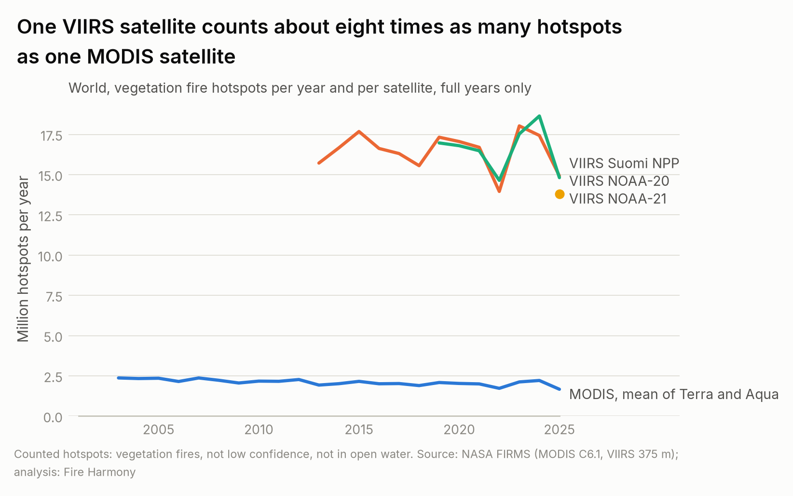{#fig-sat}

## VIIRS sees the weak fires {#sec-weak}

To compare like with like, we took 2013 to 2019, when Terra, Aqua and Suomi NPP all flew at their usual hours. At low latitudes Aqua and Suomi NPP even pass at the same local time. From here on, every count, share and median in this section is of the counted hotspots, so all of them have one base. @fig-frp shows how these hotspots spread over FRP. By day, the median Suomi NPP hotspot carries 6.8 MW and the median Aqua hotspot 22.6 MW. By night the medians are 1.5 MW and 15.8 MW.

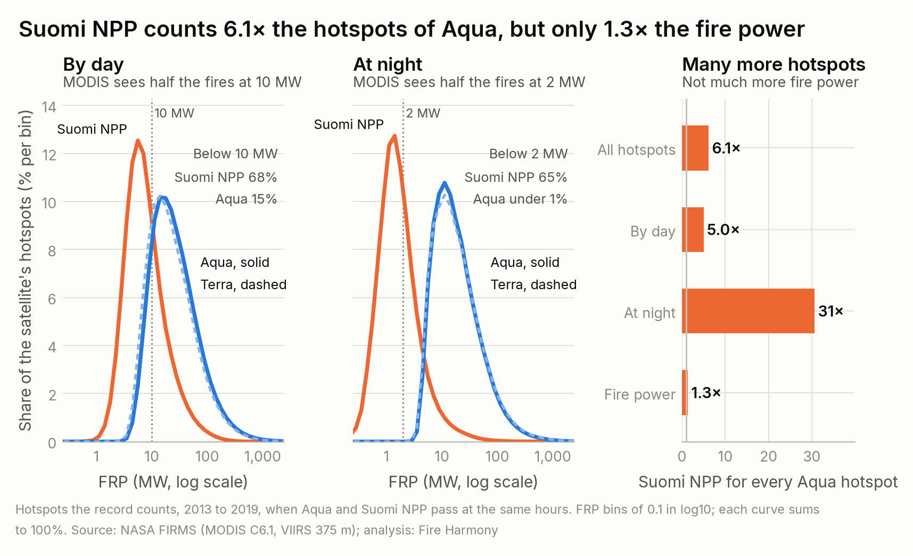{#fig-frp}

Our physics test explains the gap (@fig-physics). On 10 test areas with a clear view, Aqua saw only 44% of the fires that Suomi NPP saw by day and 46% by night. Strong fires are almost always seen, and weak ones mostly are not. By day, Aqua has an even chance of seeing a fire of about 10 MW. At night the even chance comes at about 2 MW, because a hot pixel stands out more against a cool night. Of Suomi NPP's hotspots, 68% by day and 65% by night are weaker than these limits. For Aqua the shares are 15% and under 1%.

At night the gap is extreme. At the same hour, Suomi NPP records 31 times as many night hotspots as Aqua, against 5 times by day. Of the hotspots our record counts in these years, 23% of Suomi NPP's come at night and only 4.6% of Aqua's. The more of a place's fire burns at night, the larger the gap between the two sensors (@sec-rate).

Yet the two satellites measure almost the same total fire power. Over a year, Suomi NPP counts 6.1 times as many hotspots as Aqua but records only 1.3 times its FRP. Most of the extra VIIRS hotspots therefore carry little power. Some are small fires below the reach of MODIS. Others are pieces of large fires: a 375 m pixel splits a fire front into several hotspots where a 1 km MODIS pixel shows one. The two totals are not strictly alike, because each sensor retrieves FRP in its own way [@giglio2016; @wooster2005; @li2018]. VIIRS takes the FRP of its 375 m hotspots from the 750 m M13 band, so neighbouring hotspots can share one retrieval [@schroeder2018]. MODIS pixels also grow to about 2 by 4.8 km at the edge of the swath [@giglio2003], where one pixel covers more fire. Still, a gap of 6.1 against about 1.3 points clearly to where the extra hotspots come from.

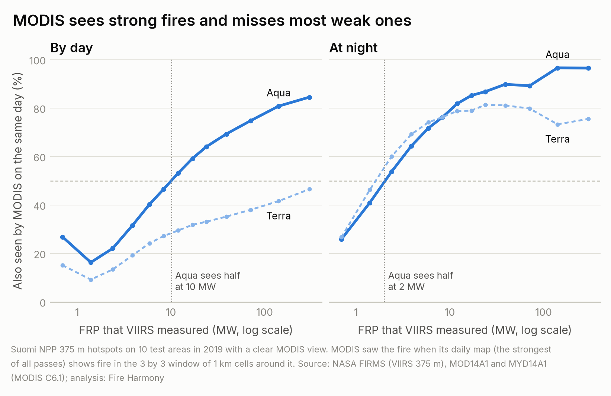{#fig-physics}

## The hour of the pass {#sec-overpass}

Each satellite crosses a place at about the same local solar time every day (@fig-overpass). From 2001 to 2020, the median Terra hotspot was seen at 10:39 by day and 22:23 by night, and the median Aqua hotspot at 13:33 and 01:39. Suomi NPP sees its median hotspot at 13:27 and 01:34, and NOAA-20 and NOAA-21 within two minutes of that. Fire has a daily cycle and burns most in the early afternoon. Aqua and VIIRS see the same burning hour, and Terra a quieter one. This is why we compare VIIRS with Aqua when we measure the gap, and why our model reads Terra and Aqua as separate inputs.

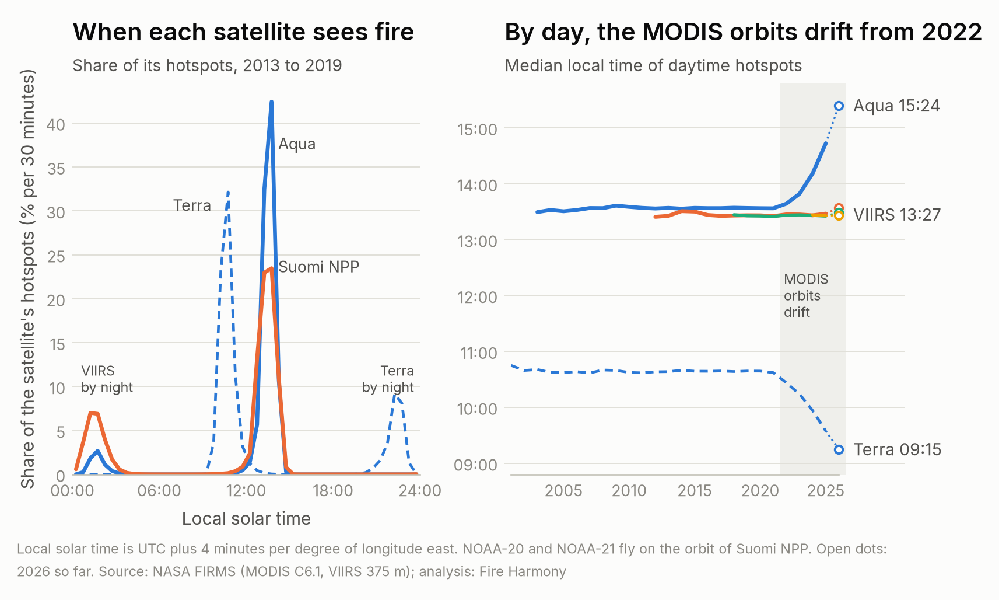{#fig-overpass}

The MODIS orbits no longer keep their hours. The first shift shows at night in 2021, when the median night hotspot moved by 11 minutes for Terra and 8 minutes for Aqua. By day the drift begins in 2022. Terra's median daytime hotspot moved earlier, to 09:35 in 2025 and 09:15 in 2026 so far. Aqua's moved later, to 14:43 in 2025 and 15:24 in 2026. A satellite that passes an hour away from its old time sees a different part of the daily fire cycle, so MODIS counts from 2021 on do not compare with earlier ones. Our record uses VIIRS for every month from 2012, so the drift does not touch it. It does touch any record built on MODIS alone (@sec-sensitivity).

## No single exchange rate {#sec-rate}

How many VIIRS hotspots stand for one MODIS hotspot? In 2013 to 2019 the world answer is 6.1 Suomi NPP hotspots for every Aqua hotspot. That is less than the eight times of @fig-sat, which compares VIIRS with the average MODIS satellite. Terra passes in the quieter morning and sees less fire than Aqua. But the answer changes from place to place (@fig-exchange). Across the 6,234 level 3 hexagons with at least 20 Aqua hotspots a year, the middle half of the rates runs from 5.5 to 8.9. One hexagon in twenty is below 4.1, and one in twenty above 13.5.

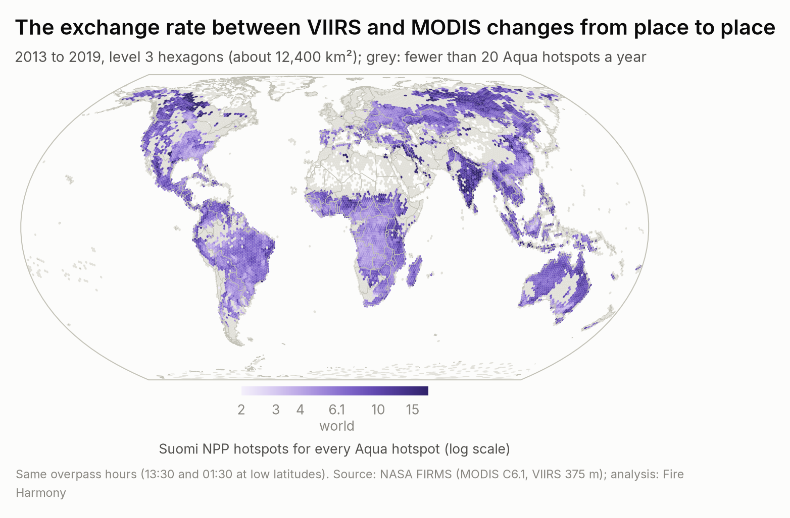{#fig-exchange}

Most of this spread comes from the night. Suomi NPP adds far more hotspots at night than by day, and the rate $R$ of a place splits exactly into its day rate and a night factor:

$$R = R_{\text{day}}\,\frac{1 - \nu_A}{1 - \nu_S},$$

where $\nu_S$ and $\nu_A$ are the shares of Suomi NPP's and Aqua's hotspots that come at night. Across the hexagons, the rate follows Suomi NPP's night share closely (Spearman's rank correlation 0.57) and hardly follows the share of weak fires by day (0.06). The day rate varies much less, with a middle half from 4.4 to 6.3. It is the day rate that rises where more of the fires are weak (0.29).

The big fire countries show the same pattern. In DR Congo and Angola, fewer than 8% of Suomi NPP's hotspots come at night, and the rate is 4.7 and 4.3. In Russia 42% come at night, and the rate is 8.8. In Canada about half do, and the rate is 11.7. India shows the day effect. There, 80% of Suomi NPP's daytime hotspots are below 10 MW, more than in any other of the 12 large fire countries we compared. Its day rate of 6.2 is second only to Canada's. Canada has the fewest weak fires of the 12. Its high day rate more likely comes from long fire fronts that VIIRS splits into many 375 m pixels.

The rate also changes with land cover (@fig-ratio) and with the season. Our model reads what Terra and Aqua saw by day and by night, where and when, so it can follow these changes, and one fixed rate cannot. Joined as they are, the two records make a fake jump of 8.4 times in 2012 (@fig-seam). The next section explains how we remove it.

::: {.callout-note title="Key finding"}
The raw record is two records. At the same hour, Suomi NPP counts 6.1 times as many hotspots as Aqua but only about 1.3 times the fire power: VIIRS adds weak fires and splits large ones. In 9 hexagons out of 10 the rate lies between 4.1 and 13.5, and it moves mostly with the share of fire that burns at night. From 2021 the MODIS orbits drift.
:::

# Methodology

@fig-pipeline shows the path from raw hotspots to the app. We wrote it as a Python package with DuckDB, a fast database that works on files [@raasveldt2019]. We also used LightGBM, SciPy, pyMannKendall, pandas, NumPy, xarray and H3 [@ke2017; @virtanen2020; @hussain2019; @h3]; the code repository lists every version. Every step can run on its own, and every step has tests.

::: {#fig-pipeline}

```{=typst}
#set par(justify: false)
#let step(t, b, fill: rgb("#fcf1ec")) = box(width: 100%, inset: (x: 6pt, y: 6pt), radius: 3pt, fill: fill, stroke: 0.5pt + rgb("#e7c0b0"))[#text(size: 8pt, weight: 600)[#t] \ #text(size: 7pt, fill: rgb("#52514e"))[#b]]
#let arrow = align(center + horizon, text(size: 10pt, fill: rgb("#c8331a"))[#sym.arrow.r])
#grid(columns: (1fr, 10pt, 1fr, 10pt, 1fr, 10pt, 1fr, 10pt, 1fr), align: horizon,
  step("Raw FIRMS", "640.6 million hotspots, 2000 to 2026"), arrow,
  step("Clean", "one schema, local solar time, H3 cells"), arrow,
  step("Mask", "factories, gas flares, volcanoes, water"), arrow,
  step("Count", "hexagon, month and satellite"), arrow,
  step("Harmonize", "VIIRS on one scale, MODIS by model"))
#v(6pt)
#grid(columns: (1fr, 10pt, 1fr, 10pt, 1fr, 10pt, 1fr, 10pt, 1fr), align: horizon,
  step("Test", "seams, placebos, burned area, physics", fill: rgb("#eef3fb")), arrow,
  step("Statistics", "normal, anomaly, critical period, trend", fill: rgb("#eef3fb")), arrow,
  step("Climate", "rain, heat, El Niño, fire weather, smoke", fill: rgb("#eef3fb")), arrow,
  step("Publish", "Parquet files for the browser", fill: rgb("#eef3fb")), arrow,
  step("Web app", "map, calendar, period, downloads", fill: rgb("#eef3fb")))
```

From raw hotspots to the web app. The top row builds the record, the bottom row tests it, explains it and serves it.
:::

## Cleaning

We turned the five satellites' files into one tidy table. Three choices matter.

**Local solar time.** A satellite pass at 01:30 local time over Indonesia happens on the previous day in UTC. We therefore date every hotspot by its local solar time: UTC plus 4 minutes for every degree of longitude east. A month then means the same thing everywhere on Earth.

**Confidence.** MODIS gives a confidence from 0 to 100%, and VIIRS gives low, nominal or high. We map MODIS below 30% to low and 80% or more to high, as NASA suggests, and we drop low confidence hotspots from the record. We also keep a count with every hotspot, so anyone can check the effect of this choice.

**Vegetation fires only.** Science quality data carry NASA's `type` label. It is 0 for a vegetation fire, 1 for a volcano, 2 for another static land source such as a gas flare, and 3 for offshore. We keep type 0 and remove hotspots in open water.

## The static source mask {#sec-mask}

Near real time data have no `type` label, so we need our own way to remove factories, gas flares and volcanoes from the last months of the record. We built a mask of level 8 hexagons (about 0.7 km²) from three sources. The first is places where science quality data often carry NASA's volcano, static source or offshore labels. The second is every site in the GIHS map of industrial heat sources, and the third is open water far from land. We built it from data up to 2022 and tested it on 2024 and 2025, against NASA's own labels (@fig-mask). It catches 96.3% of the static VIIRS detections and removes only 1.4% of real VIIRS fires. For MODIS the numbers are 87.6% and 0.8%.

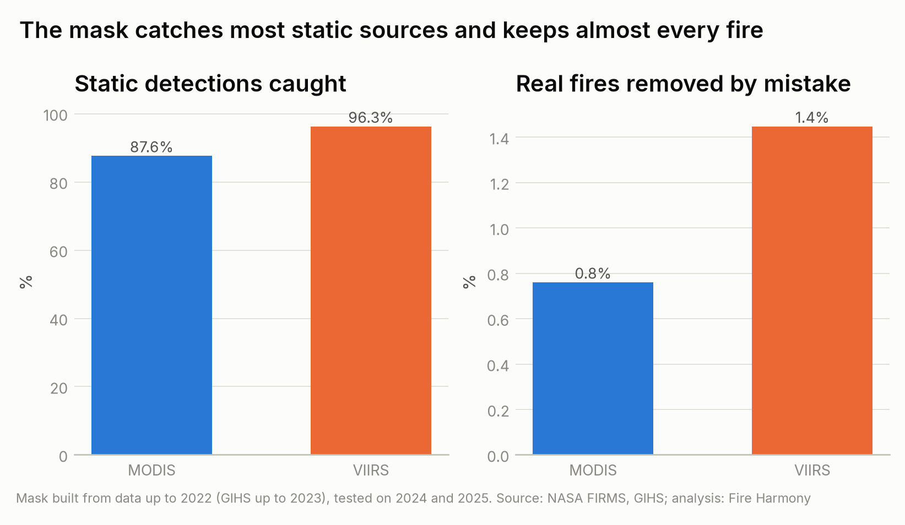{#fig-mask width=88%}

## A grid of hexagons

We count hotspots on a grid of hexagons from the H3 system [@h3]. A level 5 hexagon covers about 253 km². Hexagons have the same shape everywhere and fit together without gaps. Each one splits into about seven smaller ones, so we can add them up to any area. The record holds 413,699 level 5 hexagons, every place where a satellite ever saw a vegetation fire. For maps we use level 3 (about 12,400 km²) and level 4 (about 1,770 km²).

For every hexagon, month and satellite we count the hotspots, by day and by night, and the weak (FRP below 5 MW) and strong (50 MW or more) ones. We add up their FRP in megawatts. We also count the days with fire and the small level 7 cells (about 5 km²) that burned on each day. Last, we add facts about every hexagon: land cover, the share of peat, the number of people, and its country and state.

## Harmonization

Harmonization means putting all the satellites on one scale. We chose the scale of NOAA-20 VIIRS, the newest complete record, so every value in the app reads as "the hotspots NOAA-20 would have counted". It takes two steps. The three VIIRS satellites carry the same camera and differ only a little, so one ratio per region is enough for them. MODIS differs a lot, and in ways that change from place to place (@sec-rate), so for MODIS we learn the conversion with a model.

### All VIIRS satellites on one scale

Suomi NPP and NOAA-21 carry the same camera as NOAA-20 but pass at slightly different times. For each large region (H3 level 1, about 600,000 km²) we learned the ratio of NOAA-20 hotspots to those of each other satellite. We used the months when both flew on at least 90% of the days. A region with few hotspots leans towards the world ratio $\bar{k}_s$:

$$k_{s,r} = \frac{N_r + 2000\,\bar{k}_s}{O_{s,r} + 2000},$$

where $N_r$ and $O_{s,r}$ are the hotspots of NOAA-20 and of satellite $s$ in region $r$. The world ratios are 0.990 for Suomi NPP (learned from 2018 on) and 1.046 for NOAA-21 (from 2024 on). Then we **average** the satellites instead of adding them, after dividing each count by the share of days with data:

$$h_{c,t} = \frac{1}{|S_t|} \sum_{s \in S_t} k_{s,r(c)}\, \frac{n_{s,c,t}}{f_{s,t}}.$$

Here $n_{s,c,t}$ is the count of satellite $s$ in hexagon $c$ and month $t$, and $f_{s,t}$ is the share of that month's days on which the satellite delivered data. $S_t$ holds the VIIRS satellites with data on at least half of the days ($k = 1$ for NOAA-20). A month with three satellites in the sky does not count three times as much fire, and an outage does not look like a quiet month.

### MODIS months by machine learning

Before 2012 there is no VIIRS. For those months we predict what NOAA-20 would have counted, from what MODIS saw. The simplest answer is one exchange rate, but @sec-eda showed that there is no single rate. In the years when both flew, Suomi NPP counted 5.7 times as many hotspots as Aqua in savannas but 8.3 times as many in shrublands (@fig-ratio). Across our 10 test areas the rate ranged from 5.0 to 11.9, and from hexagon to hexagon it spreads wider still (@sec-rate). And 8.7% of Suomi NPP hotspots in 2013 to 2019 fall in level 5 hexagon months where neither MODIS satellite saw a fire, which one rate can never recover.

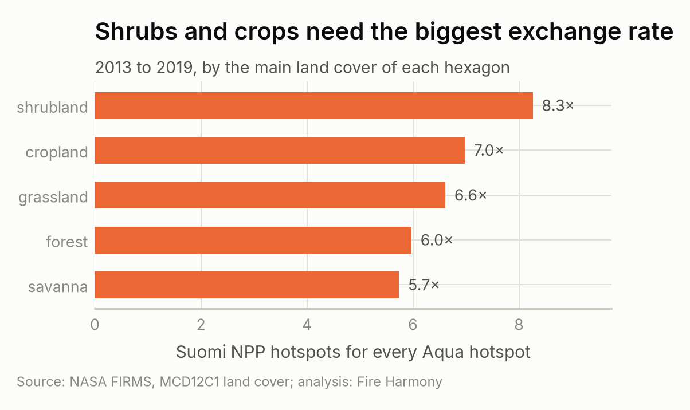{#fig-ratio width=70%}

We used gradient boosting instead, a machine learning method that builds many small decision trees, each one fixing the errors of the ones before it. We used LightGBM [@ke2017]. For every level 5 hexagon and month, the model predicts the NOAA-20 count from these inputs, each of them known before 2012:

- **What Terra and Aqua saw**, each on its own. That is the hotspots by day and by night, the weak ones (below 5 MW) and the strong ones (50 MW or more), the total FRP and the FRP per hotspot. It is also the days with fire and the level 7 cells (about 5 km²) that burned on each day. The last is the mean pixel area, which grows towards the edge of the swath. We divide each count by the share of days with data.
- **The fire around it.** The MODIS hotspots of the level 4 and level 3 hexagons that hold it. Its mean MODIS count in the same calendar month of 2003 to 2019.
- **Time and place.** The month (as a sine and a cosine) and the latitude. The share of each land cover and of peat, the population density and the biome.

The model uses a Poisson loss, which suits counts, with 600 trees of up to 127 leaves and a learning rate of 0.05. It learned from 2012 to 2019, when both MODIS orbits still kept their hours (@fig-overpass), on a fixed 35% of the level 3 regions. Most hexagon months have no fire at all, so we kept a random 5% of them and gave each a weight of 20. This keeps totals unbiased. Before July 2002 only Terra flew, so a second model uses Terra alone.

We trained and tested the model fairly. We held out two years at a time: 2012 and 2013, then 2014 and 2015, and so on to 2018 and 2019. We trained on the other years in one fifth of the level 3 regions, and tested on the held out years in a different fifth. Every score therefore comes from held out years and places. The final model learned from 2012 to 2019, so 2020 to 2025 are a true test as well. The first two of them show the model's own error out of its training years: it reads 5.5% low in 2020 and 2.8% low in 2021. The orbits only begin to drift at night in 2021 and by day in 2022 (@fig-overpass), so the drift does not explain 2020.

### Joining the Terra only years

The Terra only model could give a slightly different level from the Terra and Aqua model. For each level 1 region we therefore learned the ratio of the two models from July 2002 to June 2005, when both can run. We applied it to the Terra only months. Worldwide the factor is 1.033. Without this bridge the record would step up by 3.6% when Aqua joined. With it, the step is 0.85%. These fitting years include the year after July 2002 that the seam test of @sec-seams uses, so that test is not fully independent of the bridge.

### How sure we are

Every modelled value gets an empirical 90% range, calibrated on held out errors, in the spirit of conformal prediction [@lei2018]. The ranges come from real errors on held out data, not from a formula. For every held out total, from one hexagon in one month to a continent in one year, we took the relative error

$$e = \frac{y - \hat{\mu}}{\hat{\mu}},$$

where $y$ is what VIIRS saw and $\hat{\mu}$ is the model's total. We grouped the totals by predicted size, in bands that each span a factor of about 3 (1 to 3.2 hotspots, 3.2 to 10, and so on). In each band, the 5th and 95th percentiles of $e$, written $q_{lo}$ and $q_{hi}$, give the range

$$\left[\, \max\{0,\ \hat{\mu}\,(1 + q_{lo})\},\ \ \hat{\mu}\,(1 + q_{hi}) \,\right].$$

Months and years have their own tables, and so do the two models. Small totals get wide ranges and large ones narrow ranges. A modelled year of 1,000 hotspots has a range from 33% below to 45% above, and a year of 10,000 hotspots from 19% below to 23% above. VIIRS values from 2012 on have no range: they are measurements, not model values.

## How we tested the record {#sec-tests}

A good record should show no step where the satellites change. We tested the two seams: July 2002, when Aqua joined Terra, and January 2012, when VIIRS began.

1. **Seam steps.** We compared the year after each seam with the year before, against a witness that flew on both sides. For 2012 the witness is MODIS itself (Terra and Aqua flew on both sides). For 2002 it is Terra.
2. **Placebo seams.** We repeated the same test at dates when nothing changed. Their spread shows how big a step happens by chance. Twice that spread is about the smallest step a test can find.
3. **A witness from another agency.** ESA's Fire_cci burned area maps for 2003 to 2018 come from a separate method and team. If the record is consistent, the hotspots per km² burned should not jump at the 2012 seam. Fire_cci starts its burned patches from MODIS hotspots [@lizundia2020], so it is independent of VIIRS, not of MODIS.
4. **Change point tests.** The Pettitt test looks for one sudden change in the yearly totals [@pettitt1979]. PELT looks for changes in the monthly series, after we removed the usual season [@killick2012].
5. **Physics.** On 10 test areas in 2019, we matched every Suomi NPP hotspot to the MODIS daily fire maps of the same day. Those maps, MOD14A1 and MYD14A1, keep the strongest detection of all the passes of a day, and we counted a match within a 3 by 3 window of 1 km cells. A match means MODIS saw the fire on the same day, at any of its passes. At night this flatters MODIS, which can catch the same fire on a day pass, so the night curve of @fig-physics is likely too high.

These tests have limits, and we name them. The 2012 seam lies inside the training years 2012 to 2019. The placebo dates for 2012, from 2004 to 2011, are modelled years. The 2002 test uses the bridge years, as above.

## Statistics for any area

For any area, the app adds up its hexagons into a monthly series $v_{y,m}$, for year $y$ and calendar month $m$. The base years $B$ are 2001 to 2025, the full years of the record. A month with no data anywhere yet is unknown, not zero.

- **Normal.** The median of the same calendar month over the base years, $N_m = \operatorname{median}_{y \in B} v_{y,m}$. For a range of months, the median of the same months' totals.
- **Anomaly.** This month divided by its normal, $a_{y,m} = v_{y,m} / N_m$, for example 2.1 times normal.
- **Rank and percentile.** The rank says where this month stands among the same month of every year (1 means the most fire). The percentile is the share of base years with no more fire than this month.
- **Critical period.** We follow CONAE. Let $T$ be the 75th percentile of all base months. A calendar month is critical when $v_{y,m} > T$ in at least half of the base years.
- **Trend.** The question is simple: do later years tend to burn more than earlier ones, and by how much? We use the yearly totals $V_y$, only years with all 12 months known, and at least 8 of them. The Mann Kendall statistic $S = \sum_{i<j} \operatorname{sgn}(V_j - V_i)$ compares every pair of years. It counts how often the later one burned more, minus how often it burned less. We correct its variance for years that depend on each other [@hamed1998], and the p value is two sided. The size of the change is Sen's slope $\beta$ of $\ln(1 + V_y)$, the median of the slopes between all pairs of years [@sen1968]. We give it as $100\,(e^{10\beta} - 1)$ percent per decade, which can never fall below −100%. Its 95% interval comes from the variance of $S$ [@gilbert1987]. Our browser code gives the same answers as the Python package pyMannKendall [@hussain2019].

**Many tests at once.** A map of trends runs one test per hexagon: 7,449 at level 3, after the floor that @sec-trends explains. At p below 0.05, about 372 of them would look significant even if fire had no trend anywhere. We therefore control the false discovery rate: the expected share of false findings among all findings. We use the procedure of Benjamini and Hochberg [@benjamini1995]. Sort the $n$ p values, find the largest $k$ with $p_{(k)} \le q\,k/n$, and keep the $k$ smallest. We use $q = 0.05$, and $q = 0.10$ as a looser check. Neighbouring hexagons share weather and land, so their tests are not independent. The procedure still holds when tests are positively related [@benjamini2001], and Wilks recommends it for maps like ours [@wilks2016]. As a strict check, we also run the variant of Benjamini and Yekutieli, which holds under any dependence [@benjamini2001]. For map hexagons we first set aside those with fewer than 100 hotspots a year, and for countries and states those with fewer than 1,000. We test each kind of place on its own. A floor depends only on the mean, which does not change when the years are shuffled, so it says nothing about a trend. Setting places aside first keeps the error rate honest and gives the other tests more power [@bourgon2010].

## Why a month was unusual, and what comes next {#sec-why-methods}

**Drivers.** For every area with at least 300 hotspots a year, we fitted how fire against normal follows the weather. Areas with more than half of their fire on barren land are left aside:

$$\ln\frac{v_t + c}{N_{m(t)} + c} = \beta_0 + \beta_R R_t + \beta_T T_t + \varepsilon_t.$$

$R_t$ is the rain of this month and the two before, from GPM IMERG, as a standardised logarithm. $T_t$ is the standardised 2 m air temperature from MERRA-2. Both are anomalies against the same calendar month in 2001 to 2025. The constant $c$ is 2% of the area's mean monthly normal, so that a month with no fire does not give an infinite ratio. Each month counts by its normal fire (weighted least squares), so the fire season matters most. Physics fixes the signs: less rain and more heat can only raise fire. A term with the wrong sign is dropped and the model refitted. We scored each model on held out years, one at a time, from 2002 to 2025. We also measured how El Niño moves the rain: the correlation of the ONI index with $R_t$, at the lag of 0 to 6 months that fits best. IMERG Final ends in September 2025, so after that we use IMERG Late. We scaled it to Final for each level 3 hexagon with the year when both exist, October 2024 to September 2025.

**Outlook.** A second LightGBM model gives the chance that fire will be above normal one, two and three months ahead. Above normal means above the median of the target month in 2001 to 2025. The model reads what is known at the end of the latest month. That is the fire anomaly of this month and the two before, the rain of this month and of the last three, and last month's temperature. It also reads El Niño (ONI) and the Indian Ocean Dipole (DMI). The DMI from NOAA ends about five months before our record does. For the newest months we use our own index from MERRA-2 sea temperature, which agrees with the DMI at r = 0.78. Last come the target month, how much of the area's normal yearly fire falls in it, the latitude and the size of the area's fire. One model serves every area and lead. We scored it on blocks of held out years (2002 to 2006, 2007 to 2011, and so on to 2022 to 2025), with the Brier score $\mathrm{BS} = \frac{1}{n}\sum_i (p_i - o_i)^2$ [@brier1950; @wilks2019]. Here $p_i$ is the chance given, and $o_i$ is 1 when fire was above normal and 0 when it was not. The Brier skill score compares it with a reference:

$$\mathrm{BSS} = 1 - \frac{\mathrm{BS}}{\mathrm{BS}_{\text{ref}}}.$$

Our reference is a fixed chance of 50%, the honest answer of someone who knows only that normal is the median. Its Brier score is exactly 0.25. A score of 0 means no better than that, and 1 is perfect.[^oldref]

We give the outlook only for months of the fire season, when the normal fire is at least a fifth of an average month. Outside the season, a handful of hotspots decides the answer.

[^oldref]: Our first version used the share of other years above normal as the reference. That reference flatters the model. When a block of years is held out, the share of the remaining years above the median falls when the held out years were above it, and rises when they were below. It leans the wrong way every time, and its Brier score of 0.289 is worse than that of a fixed 50%. Against it, the skill one month ahead reads 1 − 0.213 / 0.289.

**Haze.** For 28 cities in Malaysia, Singapore, Indonesia and Brunei, we explained the monthly PM2.5 of the haze season, July to November, from MERRA-2 CNN. Smoke adds up, so the model is simple:

$$\mathrm{PM}_{t} = \mu_{m(t)} + b_S F^{S}_t + b_B F^{B}_t, \qquad b_S, b_B \ge 0.$$

$\mu_m$ is the normal level of the calendar month, and $F^{S}_t$ and $F^{B}_t$ are the harmonized hotspots, in thousands, in the two source regions, Sumatra and Borneo. We fitted it by non negative least squares and scored it on held out years, one at a time.

## The web app {#sec-webapp}

The app runs fully in the browser (@fig-app-arch). We publish the record as Parquet files on a free static host. DuckDB in the browser reads only the bytes a question needs, so there is no server to pay for, nothing to sleep, and no login. Maps use MapLibre and deck.gl with the H3 hexagons, and charts use Observable Plot.

::: {#fig-app-arch}

```{=typst}
#set par(justify: false)
#let card(t, b) = [#text(size: 8pt, weight: 600)[#t] \ #text(size: 7pt, fill: rgb("#52514e"))[#b]]
// the grid draws the card fill and border, so all four cards take the height of the tallest text
#grid(columns: (1fr, 1fr, 1fr, 1fr), column-gutter: 8pt, inset: 7pt, fill: rgb("#f6f6f3"), stroke: 0.5pt + rgb("#e3e2db"),
  card("Static files", "Parquet and JSON on a free host: record by area and hexagon, maps, 640 million hotspots in 781 region files"),
  card("DuckDB in the browser", "reads only the byte ranges a question needs, over HTTP"),
  card("Statistics in TypeScript", "normal, anomaly, rank, critical months, trend, 90% ranges, tested against Python"),
  card("Pages", "Explorer, Dashboard, Rankings, Haze, Methods and Data, on laptops and phones, dark and light"))
```

How the app works without a server.
:::

# Results

## One record without seams {#sec-seams}

@fig-seam is the heart of the project. Joined naively, world fire jumps 8.4 times from 2011 to 2012. When Aqua joined in July 2002, the harmonized record steps by 0.85% against Terra, against a placebo spread (standard deviation) of 5.0%. In January 2012 it steps by 0.55% against the MODIS witness, and at placebo dates with no satellite change the same test gives a spread of 1.2% (@fig-placebo). Both real seams look like normal years, not steps. Over three years on each side, the 2012 step is 1.65%.

```{=typst}
// the first figure of the results stays in the text flow, so it never floats above the chapter heading
#[
#show figure.where(kind: "quarto-float-fig"): set figure(placement: none)
```

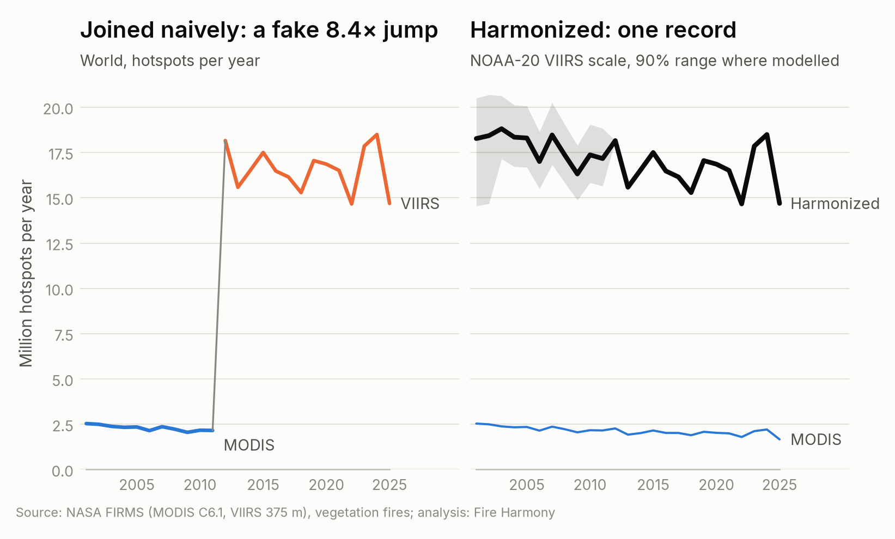{#fig-seam}

```{=typst}
]
```

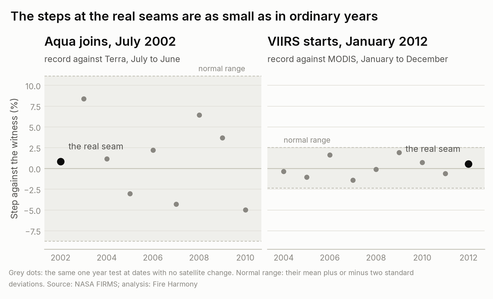{#fig-placebo}

::: {.callout-note title="Key finding"}
For the world, the record passes every seam test. The steps at the two sensor changes (0.85% in 2002 and 0.55% in 2012) are smaller than what happens by chance in ordinary years. Some regions still step, South America most: down by 6.6% at 2012.
:::

These tests can only see steps of a certain size. Twice the placebo spread is about 9.9% for the 2002 test against Terra, 2.4% for 2012 against MODIS, and 8.4% for 2012 against Fire_cci. A smaller step would go undetected. A step for the whole world can also hide regional steps that partly cancel. We therefore ran the same tests for the six continents and the 14 countries with the most fire, each against its own placebo dates. At 2012, Africa, Asia and North America step by about 1% or less. South America does not pass. It steps down by 6.6%, about five times its placebo spread of 1.3%, and by 5.7% over three years. Brazil (−7.4%) and Argentina (−6.2%) share that step. Kazakhstan steps down by 8.9% and Tanzania up by 13.4%. The steps of Oceania (+7.2%) and Europe (−14.5%) stay inside twice their wider placebo spreads. At 2002, Russia (+29%), Mozambique (+16%) and South Sudan (+7.1%) step by more than twice their spread. By chance alone, one or two of these 21 places would do so at each seam, so most of these steps are likely real. In these places, part of a trend that crosses a seam may come from the seam itself.

The witness from ESA agrees at the 2012 switch. The harmonized record counts between 2.8 and 3.2 hotspots for every km² that Fire_cci maps as burned, in every year from 2003 to 2018. The step at 2012 is 3.2% (3.3% over three years), inside the spread of 4.2% at placebo dates. The naive join would make that step 720%. The yearly totals of the two records also move together (correlation 0.86). Fire_cci builds on MODIS hotspots, so this check rules out a VIIRS step, not a shared MODIS error.

The change point tests tell the same story. In the naive join, the Pettitt test finds its strongest change in 2012 (p = 0.0003), and PELT finds breaks in November 2011 and September 2012. In the harmonized record PELT finds no break within 12 months of either seam. Its strongest Pettitt change is in 2009 (p = 0.04), far from both seams, and it follows the slow fall of world fire.

## How good the model is

On held out years and regions, gradient boosting beats the simple exchange rate for every area smaller than a continent (@fig-ladder). For regions of about 12,400 km² and one month, the median error falls from 66% to 38%. The agreement on a log scale (Lin's concordance [@lin1989]) rises from 0.87 to 0.94. For whole continents the exchange rate is a little better (5.7% against 9.9% per month), because we tune it on regional totals. For the whole world gradient boosting wins again, with a median monthly error of 1.9%. The model's total bias is small: 1.0% too low with Terra and Aqua, and 1.6% with Terra alone.

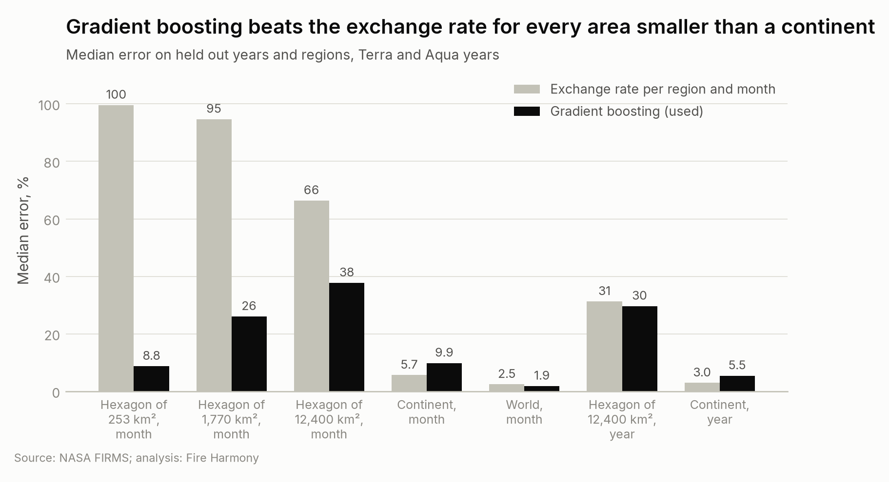{#fig-ladder}

The 90% ranges hold. Between 92% and 96% of held out monthly totals fall inside them, for every size of area, and 92% to 100% of yearly totals. What MODIS saw matters most to the model (@fig-importance). The most useful input is how many small cells burned on how many days, as Terra saw it. Terra's and Aqua's hotspot counts come next.

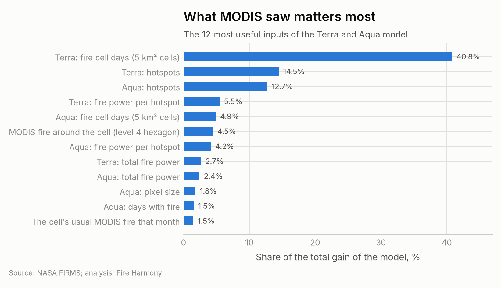{#fig-importance width=100%}

From 2012 on we can compare the model with what VIIRS really saw (@fig-model). The model tracks VIIRS within 1.5% in the training years 2013 to 2019, which is a fit, not a test. The first held out years are the hardest: the model reads 5.5% low in 2020 and 2.8% low in 2021, before the orbits drift. From 2022 it reads 2% to 5% low, as the orbits of Terra and Aqua drift to other times of day. This is why the record uses VIIRS wherever VIIRS exists, and the model only before 2012.

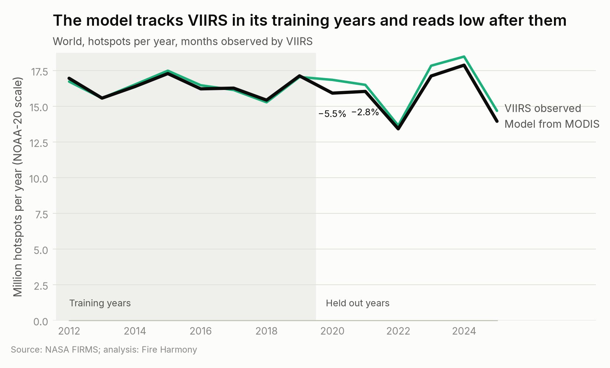{#fig-model}

## Where and when the world burns

The harmonized record holds 443 million hotspots over 26 years, about 17 million a year. Africa holds 51% of the world's fire, then Asia (18%) and South America (15%) (@fig-map, @tbl-continents). Tropical savannas hold 42% of all hotspots, more than twice as many as the next biome.

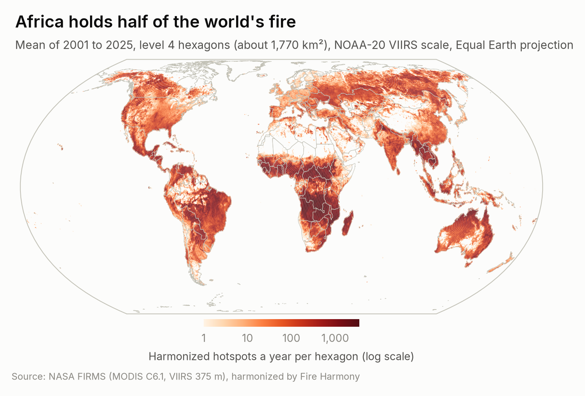{#fig-map}

```{=typst}
#show figure.where(kind: "quarto-float-tbl"): set figure(placement: auto)
```

| Continent | Hotspots per year (million) | Share of the world | Trend per decade, 2001 to 2025 | Critical months |
|:---|---:|---:|---:|:---|
| Africa | 8.76 | 51.2% | −2.2% | Jan, Jul, Aug |
| Asia | 3.11 | 18.2% | −7.9% | Mar, Apr |
| South America | 2.53 | 14.8% | −15.9% | Aug, Sep, Oct |
| Oceania | 1.14 | 6.7% | −7.2% | Oct, Nov |
| North America | 1.13 | 6.6% | +15.2% (significant) | Apr, May, Aug |
| Europe | 0.44 | 2.6% | −40.1% (significant) | Apr, Aug, Sep |

: Fire by continent in the harmonized record. Significant means p below 0.05 in the Mann Kendall test. Both significant trends also pass false discovery control at 5% across the six continents. Source: NASA FIRMS; analysis: Fire Harmony. {#tbl-continents}

```{=typst}
#show figure.where(kind: "quarto-float-tbl"): set figure(placement: none)
```

World hotspots fell by 6.3% per decade from 2001 to 2025 (p = 0.0001), with a 95% interval from 2.0% to 9.9%. A record built from MODIS alone falls faster, by 11.0% per decade, so the direction of this fall is surer than its size (@sec-sensitivity). Europe fell fastest, by 40% per decade (30% to 47%), and North America rose by 15% (3% to 32%). Both pass false discovery control across the six continents. At the looser rate of 10%, the falls in Africa, Asia and South America pass as well. A record that simply switches to VIIRS in 2012 could not show these trends, because the jump would swamp them. The next two sections test how far they can be trusted.

## How sure are the trends? {#sec-trends}

**Is there enough fire to test?** Before 2012 the model gives every hexagon month a small expected value, also where MODIS saw nothing. On average that is right, but the model spreads this fire too evenly, over deserts and ice too, while VIIRS records 0 in an empty month. Where a hexagon has almost no fire, the record therefore drops at 2012 although MODIS does not. In the 2,272 level 3 hexagons with fewer than 10 hotspots a year, our record holds 27.4 hotspots for every MODIS hotspot in 2003 to 2011 but only 11.0 in 2013 to 2021 (@tbl-floor in [Appendix E](#sec-robust)). From 100 hotspots a year up, the ratio moves by only 2% to 5%. We therefore test a map hexagon only when it has at least 100 hotspots a year. The 7,449 level 3 hexagons that pass hold 99.3% of the world's fire.

**Could chance explain it?** Of the 7,449 tested hexagons, 3,388 have a trend with p below 0.05. If fire had no trend anywhere, about 372 would pass by chance. False discovery control at 5% keeps 2,760: of every 100 hexagons we call rising or falling, we expect no more than 5 to be wrong. Fire fell in 1,950 hexagons (26%) and rose in 810 (11%), so it fell in 2.4 times as many places as it rose (@fig-trend-map). Under every rule and floor we tried, it fell in at least 2.3 times as many ([Appendix E](#sec-robust)). Neighbouring hexagons have similar trends (Moran's I of 0.63 [@moran1950]), so these are fewer independent findings than their number suggests. We therefore also tested the map as a whole. We shuffled the years 1,000 times, in blocks of three and the same for every hexagon, which keeps the links between neighbours. No shuffle found as many trends as the real map (p = 0.001), and only 4.3% leaned as far towards falls. Resampling the years in the same blocks puts the ratio of falls to rises between 1.7 and 2.5 (95% interval), and every resample has more falls than rises. The falls cover most of Europe, where 60% of the tested hexagons fall, and large parts of Kazakhstan (64%), Indonesia (59%), Brazil (39%) and Argentina (38%). The rises gather in fewer places: the Congo basin (55% of the tested hexagons of DR Congo rise), India (52%), Peru, Mozambique and Madagascar.

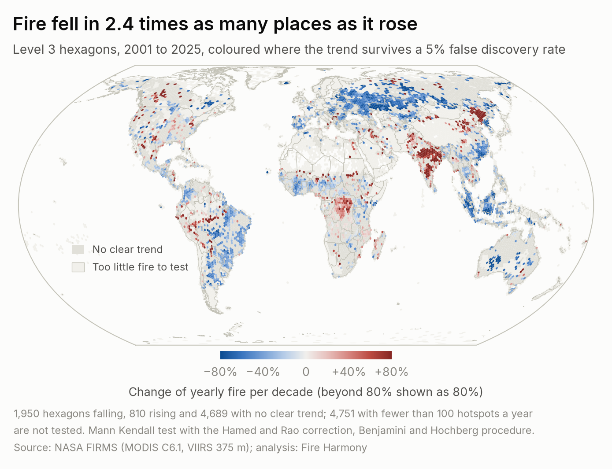{#fig-trend-map}

## Do the trends survive other choices? {#sec-sensitivity}

**Do the trends come from the seam?** If the harmonization made trends, a record built on MODIS alone would disagree with ours. That record never touches VIIRS: it is the mean of Terra and Aqua on their own scale. Before 2012 both records rest on the same MODIS observations, so this check tests the seam, not the model. From 2001 to 2025, 48 of the 49 countries with a significant trend in our record have the same sign in MODIS alone (@fig-agreement). From 2003 the agreement is complete (47 of 47), and 94% of the significant level 3 hexagons agree. Leaving out 2001 and 2002, the Terra only years, keeps the world trend at −6.3% per decade (@tbl-sensitivity in [Appendix E](#sec-robust)).

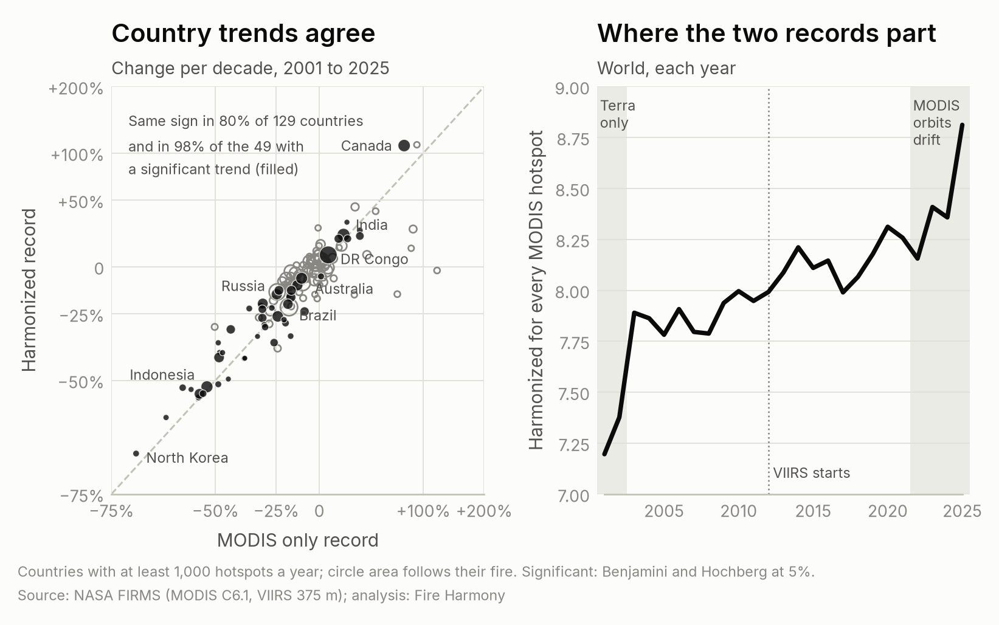{#fig-agreement}

The sizes agree less well. For the world, MODIS alone falls by 11.0% per decade where our record falls by 6.3%. Before the MODIS orbits drift, from 2003 to 2021, the gap is smaller: −7.0% against −9.8% per decade. The main open question is a slow rise in the ratio between the records. Our record held 7.89 hotspots for every MODIS hotspot in 2003 and 8.31 in 2020, before the orbits drift. Most of the rise came after 2012: from 2012 to 2021, when both records are observations, the ratio rose by 3.3%. We cannot yet say which sensor moved. We therefore read the sign of a significant trend as a finding, and its size as an estimate to set beside the MODIS only value.

**Does burned area agree?** ESA's Fire_cci burned area covers 2003 to 2018. Over those years world fire falls by 9.9% per decade in our record, by 11.7% in MODIS alone and by 9.2% in burned area, and all three falls are significant. For the world, our record sits closer to burned area than MODIS alone does. South America falls in all three, by 35%, 34% and 23% per decade. In Africa, burned area falls by 8.7% per decade while its hotspots show no clear trend.

::: {.callout-note title="The trends do not come from the change of sensor in 2012"}
Where there is enough fire to test, fire fell in 2.4 times as many places as it rose from 2001 to 2025, under every rule we tried. Of the countries with a significant trend, 98% have the same sign in a record built from MODIS alone, and so do 94% of the significant hexagons.
:::

```{=typst}
#place.flush()
```

## Burning calendars {#sec-calendars}

The burning calendar shows every month of every year as one box, coloured by the number of hotspots. It answers the challenge's questions at a glance: which months burn, which years were bad, and how this year compares. Malaysia burned about 31,800 hotspots a year in 2001 to 2005 and about 6,100 in 2021 to 2025, a fifth as many (@fig-cal-mys). Most of the fall came after 2016: from 24,079 hotspots that year to 6,312 in 2017. In Central Kalimantan in Indonesia the worst seasons, in 2015, 2006 and 2026, came with El Niño (@fig-cal-kal). In September 2026 the El Niño index (ONI) reached 2.5, a strong El Niño.

```{=typst}
// the two calendars float together as one block, stacked at the full width, with the shared colour bar under the second
#place(auto, float: true, clearance: 1.2em)[
```

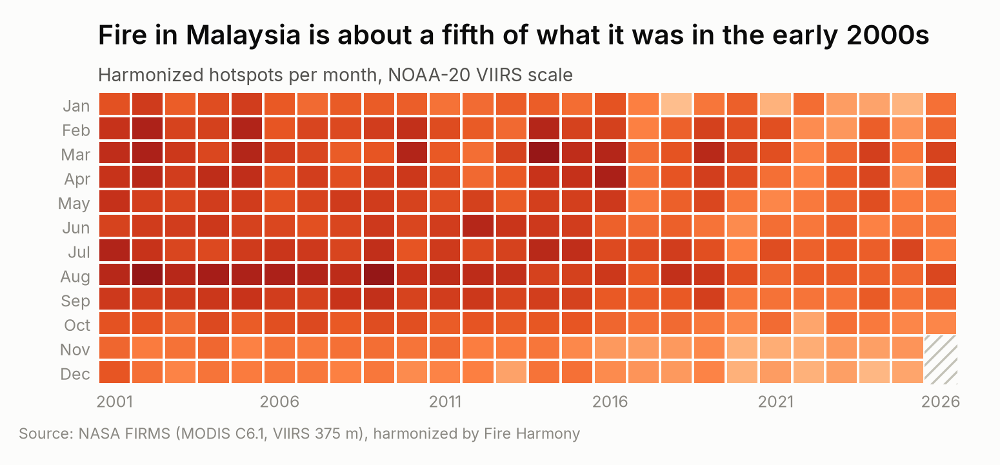{#fig-cal-mys}

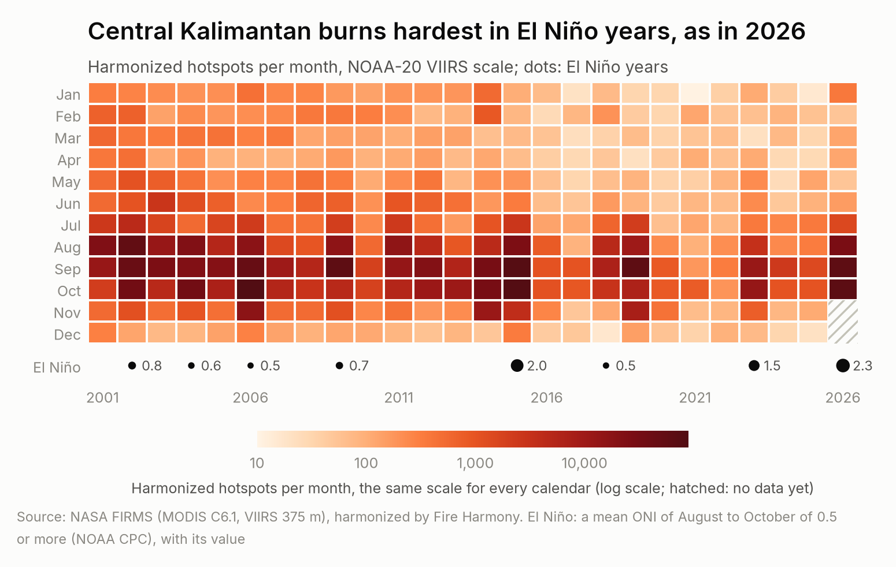{#fig-cal-kal}

```{=typst}
]
```

The normal season of an area shows its critical period (@fig-season). Fire in Malaysia and Riau peaks in August, and in Central Kalimantan in September. Riau also has a smaller season in February. By CONAE's rule, the critical period is August in Malaysia, July and August in Riau, and August to October in Central Kalimantan.

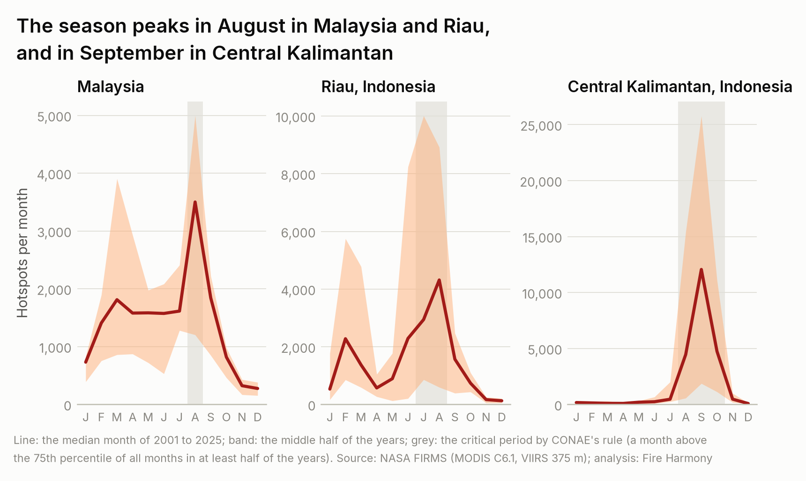{#fig-season}

In October 2026, the last full month of the record, Central Kalimantan burned 65,657 hotspots, 13.8 times its normal for October. Its September and October 2026 are the third worst since 2001, after 2015 and 2006.

### Corrientes 2022 and the Paraná delta {#sec-argentina}

The challenge comes from Argentina, so we close the calendars there (@fig-cal-arg). Corrientes, in the northeast, has its record year in 2022, the year of the Iberá fires: 43,259 hotspots. Its critical period by CONAE's rule is August and September, yet in 2022 the fire came in summer. In January it burned 24 times its normal, and in February 22,083 hotspots, 20.6 times its normal and the highest February in 26 years. In the three months to February the rain was 67% below normal, during a La Niña. Argentina as a whole burned 3.9 times its normal that February, also its highest February in 26 years.

Downstream, Entre Ríos holds the islands of the Paraná delta. Its record year is 2008. In April 2008 it burned 15,594 hotspots, 66 times its normal April, when smoke from the delta covered Buenos Aires. Both events sit across the 2012 seam without a step. In Corrientes the naive join jumps from 3,605 hotspots in 2011 (MODIS) to 22,680 in 2012 (VIIRS), while our record moves from 21,902 to 22,680. Anyone can open the case in the app, at this address:

`#align(center, box(link("https://warren-530.github.io/fire-harmony/#/?area=state:ARG-1308&month=202202&tab=calendar")[warren-530.github.io/fire-harmony/\#/?area=state:ARG-1308&month=202202&tab=calendar]))`{=typst}

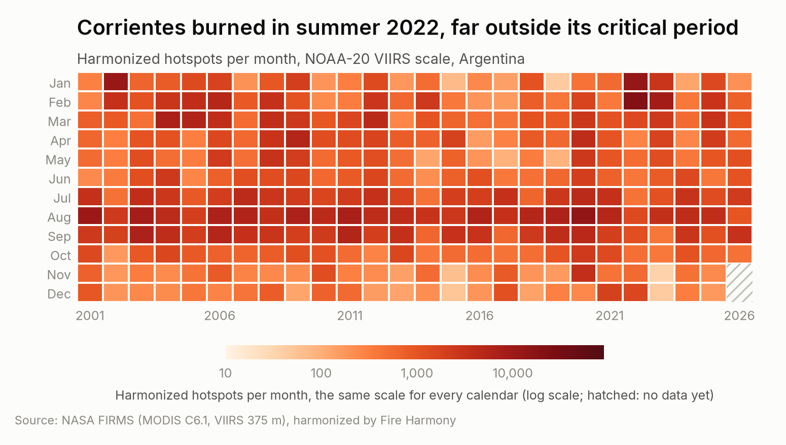{#fig-cal-arg}

## Why a month was unusual

The drivers explain fire best in the peat and forest fires of the tropics (@fig-skill). In Central Kalimantan, rain over three months explains 66% of the ups and downs of fire against normal, on held out years (@fig-drivers). Across all 1,726 areas with a model, it explains more than 20% in 23% of them. In dry savannas the link is weaker. A likely reason is that fire there depends on how much grass grew in the wet season before. The rain of the last three months does not capture that.

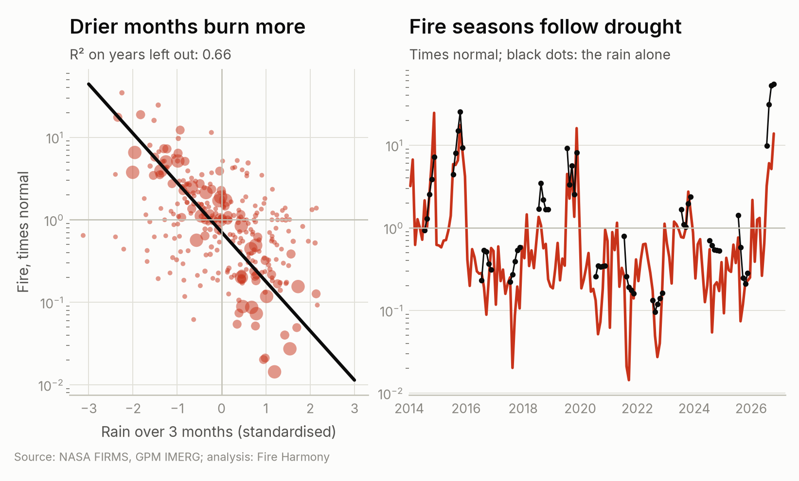{#fig-drivers}

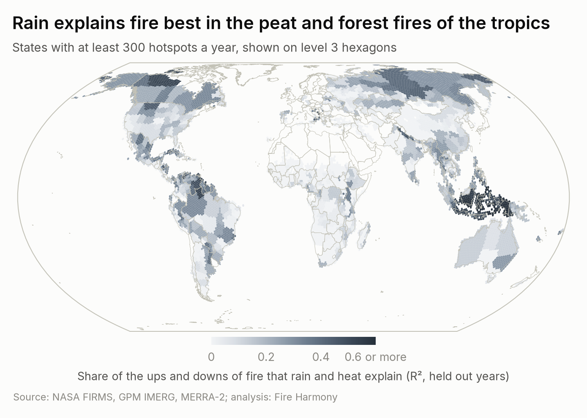{#fig-skill}

El Niño dries Indonesia, Australia and northern South America (@fig-enso). In Indonesia the correlation between El Niño and the three month rain is −0.66, and in the Philippines −0.80. This is how the record links a fire season to the ocean months before it starts.

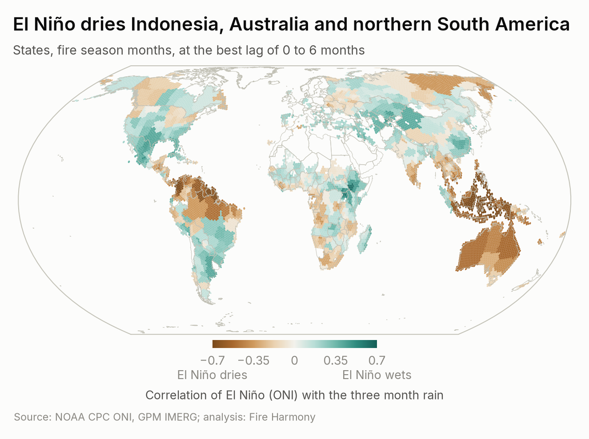{#fig-enso}

## The outlook

The outlook beats a fixed 50% chance on held out years one month ahead, and its skill fades with the lead. Its Brier score is 0.213 one month ahead, 0.234 two months ahead and 0.241 three months ahead. A fixed 50% scores 0.25, so the Brier skill score is 0.15 (95% interval 0.11 to 0.17), 0.06 and 0.04. One month ahead the outlook beats a fixed 50% in 92% of the areas we scored. Most of that skill is persistence: a forecast that reads only this month's fire anomaly already scores 0.13. Against that forecast as the reference, the outlook's Brier skill score is 0.022 (0.016 to 0.026), small but above zero. By three months the outlook knows little more than the season. Its chances are honest: when it says 74%, fire is above normal 74% of the time (@fig-outlook). The strongest input is this month's fire anomaly, followed by the season, the Indian Ocean Dipole and El Niño. Issued from October 2026, it gives Indonesia an 84% chance of above normal fire in November 2026, against a normal chance of 46%.

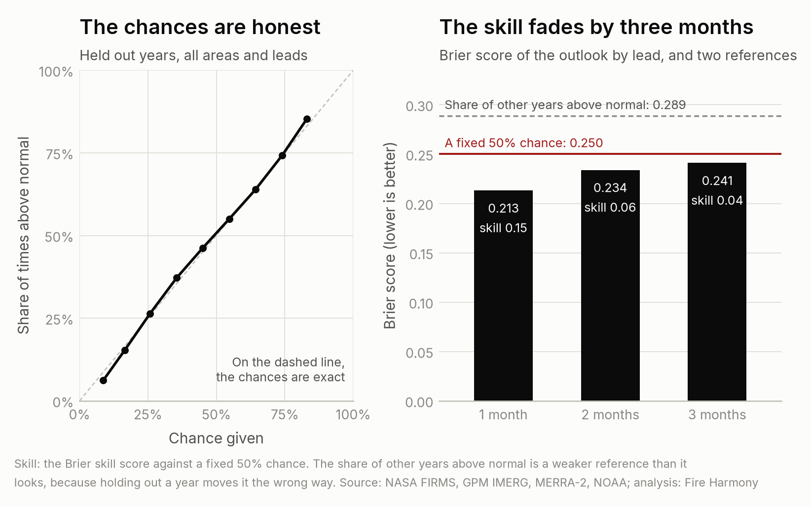{#fig-outlook}

## Fire and haze in Malaysia

Fire in Sumatra and Borneo raises the PM2.5 of the haze season in our 28 cities. We keep a city when, on years left out, the model explains at least half of its monthly PM2.5 in the season and fire explains at least 5% of what the month of the year leaves; 28 of the 36 cities we tried pass, among them all eight of our first release. In Kuala Lumpur, 88% of the modelled smoke comes from Sumatra (@fig-haze). In the 2015 season, the smoke alone added 18.3 µg/m³ to Kuala Lumpur's air on average from August to October. That alone is more than three times the level the World Health Organization considers safe as a yearly average (5 µg/m³) [@who2021]. Johor Bahru and Singapore share one MERRA-2 grid cell, so they share one result.

Two cautions apply. MERRA-2 makes its smoke from fire emissions that are themselves built from MODIS fire, in the QFED and GFED inventories [@randles2017]. The fit is therefore partly circular: the fires explain the smoke partly because the smoke was made from fires. The held out fit also includes the normal rise of PM2.5 through the season, so we do not quote it as the share of haze that fire explains. Beyond that rise, on held out years, fire explains 55% of what is left of Kuala Lumpur's ups and downs. The share ranges from 7% in George Town to 71% in Kota Kinabalu.

{#fig-haze}

## The app {#sec-app}

The web app gives all of this for any area and any range of months. It has six pages. The address of the page holds the view, so every view can be shared or saved as a link. The figures below show what a user sees, in the light theme, in which the app opens; a switch turns it dark.

`#align(center, box(link("https://warren-530.github.io/fire-harmony/")[#text(weight: 600)[warren-530.github.io/fire-harmony]]))`{=typst}

![The Explorer in its trend view, on a laptop, with India selected. A hexagon is red where fire rose from 2001 to 2025 and blue where it fell, but only where the trend holds at a 5% false discovery rate. The panel gives the latest month, the year so far, the decade trend and the yearly record with its 90% range. Address: `#box[warren-530.github.io/fire-harmony/\#/?mode=trend&area=country:IND]`{=typst}.](figures/app01_explorer_trend.jpg){#fig-app-explorer}

- **Explorer** (@fig-app-explorer). A map of hexagons for any month, in 2D or 3D, in three modes: the fire count, the fire against normal, and the trend from 2001 to 2025. The trend map follows the rules of @sec-trends. A hexagon is red or blue only when its trend survives false discovery control, and pale when it has too little fire to test. The user searches 4,329 countries, states and continents and 4,197 cities, draws a rectangle, polygon or circle, types coordinates, or clicks a hexagon. A timeline plays the months.
- **The area panel.** Under the name of the place, a strip gives the latest month, the year so far and the decade trend, each against normal. Five tabs follow. Overview gives a plain summary and the yearly record. Calendar gives the burning calendar, and Period any range of months with its total, its 90% range, its normal and its rank. Why gives the drivers, and Outlook the next three months. Download gives the monthly record as CSV, the charts as pictures and every hotspot of the area and period as CSV, with its satellite, time, fire power and confidence, and whether the record counts it. Compare pins other places to draw their yearly fire on one chart.
- **On a phone** (@fig-app-phone, left) the panel becomes a bottom sheet with three heights, like the place cards of map apps. The map never scrolls away, and every control is at least 44 pixels tall for a finger.
- **Dashboard** (@fig-app-phone, right). Every statistic of this report on one page. A scope bar sets the place or a circle around a city, the years, the months and the scale, and every chart that can follow it does.
- **Rankings** (@fig-app-rankings). All 4,330 places in one table: the world, 246 countries, 4,075 states and 8 continent groups (the six continents, Antarctica and the open ocean). The table sorts by any column and filters by continent, country, trend and amount of fire, with quick screens such as "rising fastest" and "far above normal now". A trend reads rising or falling only when it passes the false discovery rule of @sec-trends, so the Explorer, the Dashboard and Rankings always use the same word for the same place.
- **Haze, Methods and Data.** The smoke of 28 cities in Southeast Asia, every test of this report, and every file with its citation.
- **Ask**, from the header of every page. A chat panel that answers questions in plain words: how unusual a month was in a place, its worst years, its trend, its outlook, or which places rank highest. A language model (Google Gemini, on its free tier) reads the question, but it may answer only through four tools that run in the browser on the app's own files: find a place, the facts of a place, its record by month or by year, and the rankings. So every number in an answer is a number the app shows, and each answer links to the places it used, to check them on the map. It declines questions outside the fire record. The free tier allows about 160 requests a day; when they are used up, the panel says so.

![Left: the Explorer on a phone (390 by 844 pixels) in Central Kalimantan, October 2026, with the panel as a bottom sheet at half height. Right: the Dashboard, its scope bar set to the same state and to August to October. October 2026 was 13.8 times normal, the third highest October in 26 years, yet the season fell by about 78% a decade (p = 0.003 for this state alone, before any control for many tests). Addresses: `#box[warren-530.github.io/fire-harmony/\#/?area=state:IDN-1931&month=202610]`{=typst} and `#box[\#/dashboard?area=state:IDN-1931&months=8-10]`{=typst}.](figures/app02_phone_dashboard.jpg){#fig-app-phone width=86%}

![Rankings, here the countries with the most fire. The trend column applies the rule of @sec-trends: the rise of DR Congo holds when all places are tested, while the falls of Brazil and Russia are not clear. Address: `#box[warren-530.github.io/fire-harmony/\#/rankings]`{=typst}.](figures/app03_rankings.jpg){#fig-app-rankings}

The colours are safe for colour blind readers. One ember scale shows the amount of fire, and a blue to red scale shows the anomaly and the trend. Every chart has labels, a tip with its exact values and a table of its numbers. A command palette (Ctrl or Cmd and K) and keyboard shortcuts reach every view, and both themes keep text contrast at 4.5 to 1 or more.

**A short example.** A fire officer in Palangkaraya, the capital of Central Kalimantan, wants to know whether this October is unusual. She types the name of her city, and the app adds up the fire within 50 km of it. The Dashboard tells her how this October ranks among all Octobers since 2001 and how far it is above normal. The trend view shows whether fire around her has risen or fallen since 2001, and only colours a trend that passes the test. Rankings shows where her province stands among all the others. The outlook gives the chance that her province will be above normal next month. The address in her browser holds the whole view, so a colleague who opens her link sees the same thing.

```{=typst}
#place.flush()
```

# Discussion

## What the results mean

The record does what the challenge asks. It joins two sensors that see very different amounts of fire into one record. At the two sensor changes the world record steps by 0.85% and 0.55%, less than the spread of ordinary years (5.0% and 1.2%), and ESA burned area sees no step at the 2012 switch. Some places still step, South America most, by −6.6% at 2012. Every modelled value carries a 90% range, and 92% to 96% of held out monthly totals fall inside it. A fire manager in Riau or Central Kalimantan can now ask whether this season is unusual, and the answer no longer depends on which satellite flew. The outlook adds the chance of unusual fire in the month ahead. Its Brier skill score against a fixed 50% chance is 0.15 one month ahead and fades to 0.04 by three months, and when it gives a chance of 74%, fire is above normal 74% of the time.

A scientist can now measure a trend from 2001 on the scale of VIIRS, with the weak fires included. Where there is enough fire to measure, the trends hold up. World hotspots fell by 6.3% per decade from 2001 to 2025. Among the 7,449 level 3 hexagons we tested, fire fell in 2.4 times as many as it rose at a 5% false discovery rate. A record built from MODIS alone, which never touches VIIRS, gives the same sign for 98% of the countries with a significant trend. The sizes agree less well. For the world, MODIS alone falls by 11.0% per decade where our record falls by 6.3%, and half of the countries differ by more than 6.5 points. The direction of a significant trend is a finding, while its size is an estimate that depends on the record.

**How this fits what others found.** Our fall in world fire agrees with @andela2017. They found that global burned area fell by about a quarter in 18 years, most of all in savannas and grasslands where farming spreads. @jones2022 add that burned area grew in some forests of high latitudes and the western United States, while savanna fire follows fuel and farming more than the weather. Our rises in Canada and the Northwest Territories match the record season of 2023 that @jain2024 describe. In Indonesia, our correlation of −0.66 between El Niño and the three month rain fits the strong and nonlinear link between drought and fire that @field2016 found for 2015. Our ratio of 6.1 Suomi NPP hotspots for every Aqua hotspot, but only about 1.3 times the fire power, fits @li2018. They found that the fire power of VIIRS and MODIS is comparable at the scale of continents, and that what MODIS sees depends strongly on its viewing angle.

Two results surprised us. First, the exchange rate between the sensors is not a constant. It depends most on how much of the fire burns at night, and by day on how weak the fires are, and both change with land cover and season. A single factor would bias every region in its own way. Second, the drift of the MODIS orbits shows in our tests, at night from 2021 and by day from 2022. It is a reason to use the model only where VIIRS does not exist.

## Limits {#sec-limits}

- **A stable link.** The model learned 2012 to 2019 and assumes that the link between MODIS and VIIRS held from 2001. We cannot test that before 2012. The first held out year, 2020, is off by −5.5%.
- **Clouds and smoke.** Clouds and thick smoke hide fires from both sensors. A cloudy fire season shows fewer hotspots than burned.
- **Hotspots are not burned area.** The record counts active fire pixels. It does not measure burned area or emissions.
- **What the 90% range covers.** It covers the model's error against VIIRS counts in 2012 to 2019, on held out years and places. It leaves out four things: the step from those years back to 2001, and the bridge from Suomi NPP to NOAA-20 (k = 0.990) applied back to 2012. It also leaves out the change from science quality to near real time data, and the net effect of the static mask.
- **Regional steps.** The world passes the seam tests, but some places do not (@sec-seams). At 2012, South America steps down by 6.6%, with Brazil and Argentina, and Kazakhstan and Tanzania step too. A trend that crosses 2012 in these places carries part of that step, so its size is less sure.
- **Terra only years.** In 2001 and 2002 the model puts 22% and 15% of the record into hexagon months where MODIS saw nothing, against 7% to 8% from 2003. These two years rest on one satellite and lean on the model most.
- **Places with little fire.** Before 2012 the model gives every month a small expected value, also where MODIS saw nothing. Where a place has fewer than about 100 hotspots a year, these values are much of its record before 2012, so its fire seems to fall at 2012 (@tbl-floor). States show the same. In states with fewer than 10 hotspots a year, the record of 2003 to 2011 is a median 2.9 times that of 2013 to 2021, against 1.10 times in states with 1,000 or more. We do not test the trends of such map hexagons, and the app warns where a place has too little fire for its trend to mean much.
- **Drivers are associations.** Rain and heat explain more than 20% of the ups and downs of fire in only 23% of the areas. The rain term includes the current month, so clouds that hide fires can make the link look stronger.
- **The newest climate months.** The last months of the Indian Ocean Dipole come from our MERRA-2 proxy (r = 0.78). Rain after September 2025 comes from IMERG Late, bridged to IMERG Final. NASA moved IMERG Late to version V07C on 3 March 2026, after the year we used for the bridge, so a small step is possible.
- **Breaks in the monthly record.** PELT finds four breaks in the harmonized record: July 2008, November 2021, February 2023 and October 2024. The last three also show in MODIS alone, so they are fire events, such as the Canadian season of 2023. The first marks the start of the quieter years after the late 2000s.
- **Lava.** Lava far from listed volcanoes, as in Iceland in 2014 and 2021, carries NASA's vegetation fire label and shows as fire.
- **The newest months.** The last months use near real time data, which our own mask cleans. The mask removes 1.4% of real VIIRS fires.
- **Extreme drought.** The driver model can overshoot in extreme drought, so the app says "more than 10 times normal" instead of a precise number.
- **The MODIS scale view.** Our record on the MODIS scale dips by about 7% in Aqua's first year (July 2002 to June 2003). The harmonized record does not.
- **Hexagon size.** The record works at about 253 km². It shows where and when burning happens, not the edge of a single fire.
- **Trends.** A trend sums up 25 years, not a steady rate. Its size depends on the record, and neighbouring hexagons are not independent, so a significant region means more than a significant hexagon.
- **The outlook.** It covers months of the fire season only, gives a chance, not a certainty, and has little skill by three months. One month ahead, most of its skill comes from this month's fire.

## How we answer the challenge

```{=typst}
#show figure.where(kind: "quarto-float-tbl"): set block(breakable: false)
```

| The challenge asks for | Fire Harmony |
|:---|:---|
| Harmonize MODIS and VIIRS hotspots | One record on the NOAA-20 scale, with tests at both seams and a 90% range |
| Select a region | Search 4,329 places or 4,197 cities, draw a rectangle, polygon or circle, type coordinates, or click a hexagon |
| Select a date range | Any range of months, with presets for the last 12 months, this year and the fire season |
| A burning calendar from the early 2000s | Every month from November 2000 to October 2026 |
| Compare a current fire with previous ones | The anomaly, rank and percentile of every month and every range of months, and rankings of every place |
| Trends that can be trusted | Mann Kendall trends with false discovery control, checked against a record from MODIS alone |
| Download analytics and visualizations | CSV of the monthly record and of every hotspot, and pictures of the calendar and charts |
| Accessible colours | Colour blind safe scales, labels and tables for every chart |

: How the app answers each part of the challenge. {#tbl-answer}

```{=typst}
#show figure.where(kind: "quarto-float-tbl"): set block(breakable: true)
```

## Who would use it, and what it costs {#sec-users}

**It costs nothing to run.** The record is a set of static Parquet files on a free host, and the browser does all the work (@sec-webapp). There is no server to pay for or keep awake.

**A daily update is a short job.** The model does not need to learn again. Each day a scheduled job would download the new near real time hotspots from FIRMS, clean and mask them, add them to the current month, and publish the small files of the last months again. A free scheduled runner on GitHub can do this, so the running cost stays at zero. Only an alert service would need a small paid server.

**First users.** CONAE and Argentina's fire services, for the critical periods and the record seasons of each province. In Malaysia, the Fire and Rescue Department (BOMBA) and the Department of Environment, which reports haze. The ASEAN Specialised Meteorological Centre, which watches hotspots and haze across the region. Plantation and peat land managers, who must show that their land does not burn.

**A path to revenue.** The record stays free and open. Paid services could sit on top of it: alerts when an area burns far above normal, and an API for plantations and insurers who need the history of fire on their land.

# Conclusion

We built one consistent worldwide fire record from MODIS and VIIRS, from November 2000 to October 2026. It removes a fake jump of 8.4 times at the sensor change. At both seams the world record steps by less than 1%, 0.85% in 2002 and 0.55% in 2012, inside the normal noise of ordinary years, and ESA burned area sees no step at the 2012 switch. South America is the clear exception, with a step of 6.6% at 2012. Every modelled value has a 90% range, and 92% to 96% of held out monthly totals fall inside it.

The record shows that Africa holds half of the world's fire, and that world hotspots fell by 6.3% per decade from 2001 to 2025. A record from MODIS alone falls by 11.0%. Where there is enough fire to test, fire fell in 2.4 times as many places as it rose at a 5% false discovery rate. A record built from MODIS alone has the same sign for 48 of the 49 countries with a significant trend. In Indonesia the worst fire years still follow El Niño, as 2026 shows. The outlook beats a fixed 50% chance one month ahead, with a Brier skill score of 0.15, and its skill fades to 0.04 by three months.

On top of the record, a free web app serves any area and any range of months, on a laptop or a phone. It gives a burning calendar, the anomaly against normal, a map of tested trends, rankings of every place, the drivers of unusual fire, the outlook and downloads.

Next, we want to add CONAE's hotspot catalogue for Argentina and test the record against more burned area maps. We also want to update it every day from FIRMS, and to send alerts for areas whose fire is far above normal.

# References {.unnumbered}

```{=typst}
#[
#set par(justify: false, hanging-indent: 1.4em, leading: 0.6em)
#set text(size: 8.8pt)
#show par: it => block(breakable: false, above: 0.62em, below: 0.62em, it)
```

::: {#refs}
:::

```{=typst}
]
```

```{=typst}
#pagebreak(weak: true)
```

# Appendix A. Novelty and comparison {.unnumbered}

| Element of novelty | How Fire Harmony meets it |
|:---|:---|
| Unique problem solving | A record that is consistent across sensors, not just a map of today's fires |
| Original concept | The exchange rate between sensors learned per place and month, with the fire physics measured |
| Innovative technology | Gradient boosting, empirical 90% ranges, H3 hexagons and DuckDB in the browser |
| Market differentiation | Burning calendar, anomaly, drivers and outlook for any drawn area, free and without login |
| Interdisciplinary approach | Remote sensing, statistics, machine learning, climate science, public health and design |
| User centred design | One map, a timeline, plain language, a bottom sheet on phones, keyboard shortcuts, dark and light themes |
| Rigorous validation | Seam tests with placebos, an independent witness from another agency, and the limits of each test |
| Environmental and social impact | Haze in Malaysia and its neighbours, and critical periods for fire managers |
| Comparative analysis | See the table below |
| Validation | Every model score comes from held out years and regions |

: The handbook's ten elements of novelty. {#tbl-novelty}

| Tool | What it does | What Fire Harmony adds |
|:---|:---|:---|
| NASA FIRMS Fire Map | Hotspots of each sensor, near real time and archive | One consistent record across sensors, calendars, anomalies and trends |
| GWIS (Global Wildfire Information System) | Fire danger forecasts, active fire and burned area maps, and country statistics | Any drawn area, a hotspot record from 2000 on one scale, tested trends, an outlook with tested skill |
| Global Forest Watch | VIIRS fire alerts for drawn areas, compared with recent years | One record from 2000 on one scale, tested trends, burning calendar, outlook |
| Global Fire Atlas | Individual fires from MODIS burned area, 2003 to 2016 | Up to the last month, VIIRS scale, and a web app for any area |
| Raw MODIS and VIIRS archives | Separate records on different scales | The harmonization itself, with its tests and 90% ranges |

: Comparison with existing tools. {#tbl-compare}

# Appendix B. The eight pillars {.unnumbered}

```{=typst}
#show figure.where(kind: "quarto-float-tbl"): set block(breakable: false)
```

| Pillar | Question | Our answer |
|:---|:---|:---|
| Science | Have we understood the scientific problem? | We measured why the sensors differ, fire by fire, on 10 test areas |
| Technology | Have we used appropriate technology? | DuckDB, H3, LightGBM, and a web app that needs no server |
| Research | Have we researched reliable information? | NASA and ESA data with DOIs, a checked copy of FIRMS, and published methods |
| Engineering | Have we built and tested something? | A tested pipeline and app, with 13 browser test scripts and about 190 Python tests |
| Entrepreneurship | Who could use or benefit from it? | Fire agencies, haze agencies, plantations, insurers, researchers and the public (@sec-users) |
| Art | Can we communicate the idea clearly? | One visual style, calendars and maps, and plain English |
| Mathematics | Have we analysed relevant data correctly? | Held out tests, placebo seams, change point tests, calibrated ranges, and false discovery control for every map of trends |
| Design | Is the solution understandable and usable? | One map, a timeline, presets, and every download one click away |

: The handbook's eight pillars. {#tbl-pillars}

```{=typst}
#show figure.where(kind: "quarto-float-tbl"): set block(breakable: true)
```

# Appendix C. How to rebuild our results {.unnumbered}

The code is open under the Apache 2.0 licence. It needs Python 3.12 and about 60 GB of disk.

1. Download the data with the scripts in the repository. They check every file against its checksum.
2. Run `run_phase1.sh` (cleaning, mask and counts), `run_phase2.sh` (hexagon facts, models and seam tests) and `run_phase3.sh` (climate, drivers, haze and outlook).
3. Run `fireharmony publish` to write the app's files and `run_notebooks.sh` to rebuild the figures of the notebooks. Then run `fireharmony eda --figures` for the raw record and the trend checks. It writes @tbl-sensors, @tbl-floor, @tbl-fdr, @tbl-places-countries, @tbl-places-states and @tbl-sensitivity, and draws @fig-frp, @fig-overpass, @fig-exchange, @fig-trend-map and @fig-agreement.
4. Run the app with `npm run dev` in the `app` folder.

The notebooks `00` to `10` explain every step in plain language, with the code and its output.

# Appendix D. Glossary {.unnumbered}

```{=typst}
#show table: it => block(breakable: false, it)
```

| Term | Meaning |
|:---|:---|
| Hotspot | One pixel that a satellite marked as unusually hot, usually a fire |
| MODIS | A sensor on NASA's Terra and Aqua satellites, with 1 km fire pixels at nadir |
| VIIRS | A newer sensor on Suomi NPP, NOAA-20 and NOAA-21, with 375 m fire pixels at nadir |
| Harmonization | Putting the records of different sensors on one scale |
| Seam | A date when the satellites change, here July 2002 and January 2012 |
| Placebo | The same test at a date when nothing changed, to see what chance alone gives |
| Held out | Kept apart while a model learns, and used only to test it: years, places or both |
| H3 hexagon | A cell of a worldwide grid of hexagons; level 5 covers about 253 km² |
| Normal | The median of the same calendar month over 2001 to 2025 |
| Anomaly | A value divided by its normal, for example 2 times normal |
| Critical period | The months that are usually the worst for fire in an area |
| FRP | Fire radiative power, the rate at which a fire radiates energy, in megawatts |
| False discovery rate | The expected share of false findings among all the findings of many tests |
| Local solar time | The time of day set by the sun: UTC plus 4 minutes for every degree of longitude east |
| Gradient boosting | A machine learning method that adds many small decision trees |
| 90% range | The range that holds the true value 9 times in 10, set from the model's held out errors |
| Brier skill score | How much better a forecast of chances is than a fixed chance of 50% |
| Mann Kendall test | A test of whether later years tend to have more (or less) fire than earlier ones, without assuming a straight line |
| Sen's slope | The median of the slopes between all pairs of years: a size of trend that one odd year cannot move |
| Moran's I | A measure of how much neighbouring places resemble each other; 0 means not at all |
| Exchange rate | The VIIRS hotspots for every MODIS hotspot in the same place and time |
| PM2.5 | Tiny particles in the air, smaller than 2.5 micrometres, measured in µg/m³ |

```{=typst}
#pagebreak(weak: true)
```

# Appendix E. How robust are the trends {.unnumbered #sec-robust}

This appendix holds the detail behind @sec-trends and @sec-sensitivity: the floor, the false discovery rules, the countries and states, and the other choices we tried.

**The floor.** In 2003 to 2011 the model puts 7.7% of the record into level 5 hexagon months where neither MODIS satellite saw a fire. In 2013 to 2021, VIIRS finds 8.7% of its fire in such months. On average the two agree, but the model spreads this fire too evenly. The 2,272 level 3 hexagons with fewer than 10 hotspots a year together hold under 0.1% of the world's fire. Tested without a floor, 1,532 of them fall and 17 rise, and only 14% share the sign of their trend with MODIS alone (@tbl-floor). From 100 hotspots a year up, the ratio moves by only 2% to 5%. There, 72% to 87% of the hexagons share the sign of MODIS alone. The floor also fits our 90% ranges. A modelled year of 100 to 316 hotspots has a range from 58% below to 102% above, and below about 32 hotspots the range reaches zero.

| Hotspots a year | Hexagons | Share of fire | Falling | Rising | Per MODIS hotspot, 2003 to 2011 | Per MODIS hotspot, 2013 to 2021 | Same sign as MODIS alone |
|:---|---:|---:|---:|---:|---:|---:|---:|
| Under 10 | 2,272 | under 0.1% | 1,532 | 17 | 27.4 | 11.0 | 14% |
| 10 to 30 | 996 | 0.1% | 452 | 48 | 13.7 | 10.0 | 29% |
| 30 to 100 | 1,483 | 0.5% | 511 | 118 | 10.3 | 9.4 | 58% |
| 100 to 300 | 1,703 | 1.8% | 443 | 207 | 8.8 | 9.0 | 72% |
| 300 to 1,000 | 2,368 | 8.2% | 615 | 278 | 8.1 | 8.6 | 81% |
| 1,000 or more | 3,378 | 89.3% | 954 | 350 | 7.8 | 8.1 | 87% |

: Where the extra falls come from. Level 3 hexagons by their mean harmonized hotspots a year, 2001 to 2025. Falling and rising: trends that pass false discovery control at 5% among all 12,200 hexagons, with no floor. The next two columns give our record's hotspots for every MODIS hotspot in the model years and in the VIIRS years. Same sign: the share of hexagons whose trend from 2003 to 2025 has the same sign in the MODIS only record, among those with a trend in both. Source: NASA FIRMS; analysis: Fire Harmony. {#tbl-floor tbl-colwidths="[15,10,14,9,8,15,15,14]"}

**The rules.** With the floor, fire falls in 2.4 times as many hexagons as it rises. Without the floor the ratio would be 4.4, inflated by the nearly empty hexagons. With floors from 10 to 300 hotspots a year it stays between 2.4 and 3.0. The strict variant that holds under any dependence keeps 1,514 hexagons, and fire still falls in 2.3 times as many as it rises. For maps like ours, Wilks shows that a rate of 10% keeps the chance of a false pattern on the map near 5% [@wilks2016]. Moran's I of the trend scores of the tested hexagons is 0.63, where 0 would mean no link between neighbours (p = 0.001 from 999 random reshuffles). Of the significant hexagons, 87% touch another one with the same sign. Only hexagons with p up to 0.0184 pass, so the rounding of p values to four decimals in our files changes nothing.

A test can pass while Sen's slope is exactly 0. This happens when most years hold the same value, often no fire at all, so that the median of the slopes between pairs of years is 0 while the signs still lean one way. We count such a hexagon as neither rising nor falling, and it does not enter the ratio. Among the tested hexagons it never happens at level 3 and at most twice at level 4, depending on the rule. Without the floor it happens to 1 level 3 hexagon and to 190 at level 4, almost all of them below the floor of 100 hotspots a year (@tbl-fdr).

| Hexagons and rule | Level 3, rising | Level 3, falling | Level 4, rising | Level 4, falling |
|:---|---:|---:|---:|---:|
| Every hexagon (no floor): false discovery rate 5% | 1,018 (8.3%) | 4,507 (36.9%) | 5,053 (7.3%) | 28,784 (41.6%) |
| At least 100 a year: p below 0.05 | 1,016 (13.6%) | 2,372 (31.8%) | 3,311 (12.4%) | 9,387 (35.1%) |
| At least 100 a year: false discovery rate 5% | 810 (10.9%) | 1,950 (26.2%) | 2,687 (10.0%) | 7,726 (28.9%) |
| At least 100 a year: false discovery rate 10% | 993 (13.3%) | 2,313 (31.1%) | 3,295 (12.3%) | 9,319 (34.8%) |
| At least 100 a year: rate 5%, any dependence | 456 (6.1%) | 1,058 (14.2%) | 1,410 (5.3%) | 4,070 (15.2%) |

: Hexagons with a rising or falling trend of yearly fire, 2001 to 2025. The first row tests every hexagon with at least five years of fire: 12,200 at level 3 (about 12,400 km²) and 69,242 at level 4 (about 1,770 km²). The other rows test only hexagons with at least 100 hotspots a year: 7,449 at level 3 and 26,745 at level 4. Shares are of the hexagons each row tests. False discovery rates follow Benjamini and Hochberg, and "any dependence" follows Benjamini and Yekutieli. A trend that passes with a Sen's slope of exactly 0 counts as neither rising nor falling. That is 1 level 3 and 190 level 4 hexagons in the first row, and in the other rows none at level 3 and at most 2 at level 4. Source: NASA FIRMS; analysis: Fire Harmony. {#tbl-fdr tbl-colwidths="[32,17,17,17,17]"}

**The size of the hexagons.** At level 4 the same floor keeps 26,745 hexagons with 94% of the world's fire. Of them, 39% have a trend that survives the control, against 37% at level 3, and fire falls in 2.9 times as many as it rises. Of the level 4 hexagons, 82% share the sign of the trend of their level 3 parent. Where both are significant, 99% agree.

**Countries and states.** We ranked only places with at least 1,000 hotspots a year on the NOAA-20 scale. A modelled year of that size has a 90% range from 33% below to 45% above. Smaller years have wider ranges, from 45% below to 61% above for 316 to 1,000 hotspots, as wide as the trends we want to find. We also set aside places with more than half of their fire on barren land, where lava and gas flares pass for fire: eight countries, Iceland among them. That still leaves 129 countries with 99.5% of the world's fire, and 1,048 states with 97%. With a floor of 300 or 3,000 instead, about a third of the countries still fall (32% to 34%) and 6% to 7% rise.

Of the 129 countries, 49 have a trend that survives the control: 41 fall and 8 rise (@tbl-places-countries). India's rise of 21.5% per decade is one of them (q = 0.0006, the p value adjusted for the number of tests). Brazil's fall of 21.8% is not. Its p value of 0.023 would look convincing alone, but among 129 tests it becomes q = 0.057, so it passes only at the looser rate of 10%. Canada rises fastest, by 109% per decade, and its three biggest years are 2023, 2024 and 2025. That rise leans on those three years, which hold 41% of its fire since 2001. Up to 2022, Canada rises by 51% per decade (p = 0.03), and from 2003 to 2022 its rise is no longer significant (p = 0.34). Malaysia and Indonesia fall by more than half per decade. Among states (@tbl-places-states), Riau and Central Kalimantan fall by about 75% per decade, and Bihar and Rajasthan in India rise by 79% to 91%. Both tables list the fastest of many tests, so the sizes they show are inflated: the fastest of many estimates is more often too fast than too slow.

| Place | Hotspots a year | Change per decade | p | q |
|:---|---:|---:|---:|---:|
| Canada | 311,931 | +109.4% | below 0.0001 | 0.0003 |
| North Macedonia | 1,604 | +31.2% | 0.0010 | 0.0043 |
| Niger | 5,966 | +24.8% | 0.0005 | 0.0024 |
| India | 389,191 | +21.5% | 0.0001 | 0.0006 |
| Pakistan | 44,700 | +20.6% | below 0.0001 | below 0.0001 |
| Iran | 27,961 | +18.7% | 0.0083 | 0.024 |
| Peru | 64,222 | +18.6% | below 0.0001 | 0.0005 |
| DR Congo | 1,626,810 | +7.5% | below 0.0001 | below 0.0001 |
| North Korea | 6,793 | −68.0% | below 0.0001 | 0.0003 |
| Hungary | 2,708 | −60.1% | below 0.0001 | below 0.0001 |
| Belarus | 7,524 | −54.9% | 0.0002 | 0.0010 |
| Kazakhstan | 149,829 | −53.9% | 0.0007 | 0.0030 |
| Malaysia | 19,397 | −53.9% | below 0.0001 | 0.0002 |
| Kyrgyzstan | 1,948 | −52.7% | below 0.0001 | below 0.0001 |
| Mongolia | 15,367 | −52.2% | 0.011 | 0.029 |
| Indonesia | 271,567 | −51.9% | 0.0035 | 0.012 |
| Bulgaria | 8,294 | −51.2% | below 0.0001 | 0.0005 |
| Afghanistan | 1,552 | −49.6% | below 0.0001 | 0.0002 |

: Countries whose trend of yearly fire, 2001 to 2025, survives false discovery control at 5%: all 8 that rise, then the 10 that fall fastest. Only places with at least 1,000 hotspots a year and less than half of their fire on barren land. q is the p value adjusted by the procedure of Benjamini and Hochberg. Source: NASA FIRMS; analysis: Fire Harmony. {#tbl-places-countries tbl-colwidths="[31,16,15,19,19]"}

| Place | Hotspots a year | Change per decade | p | q |
|:---|---:|---:|---:|---:|
| Northwest Territories, Canada | 70,624 | +303.2% | 0.0009 | 0.0035 |
| Jilin, China | 20,547 | +180.5% | below 0.0001 | below 0.0001 |
| Erbil, Iraq | 1,277 | +123.4% | 0.0019 | 0.0068 |
| Kohgiluyeh and Buyer Ahmad, Iran | 1,571 | +116.9% | 0.012 | 0.031 |
| Zamfara, Nigeria | 12,859 | +100.1% | 0.0019 | 0.0068 |
| Sagarmatha, Nepal | 1,117 | +97.3% | below 0.0001 | below 0.0001 |
| Bihar, India | 6,367 | +91.2% | below 0.0001 | below 0.0001 |
| North Darfur, Sudan | 5,059 | +81.2% | 0.0003 | 0.0016 |
| Rajasthan, India | 6,366 | +79.3% | below 0.0001 | below 0.0001 |
| Alberta, Canada | 43,471 | +77.9% | 0.015 | 0.037 |
| Khentii, Mongolia | 2,780 | −82.7% | 0.0035 | 0.011 |
| West Kazakhstan, Kazakhstan | 12,254 | −78.4% | below 0.0001 | below 0.0001 |
| Kangwon, North Korea | 1,581 | −75.9% | below 0.0001 | 0.0002 |
| Central Kalimantan, Indonesia | 47,423 | −75.8% | 0.0030 | 0.010 |
| Riau, Indonesia | 36,266 | −74.3% | 0.0006 | 0.0025 |
| South Hamgyong, North Korea | 1,153 | −74.1% | 0.0003 | 0.0012 |
| Khövsgöl, Mongolia | 1,311 | −71.2% | 0.011 | 0.029 |
| Aktobe, Kazakhstan | 18,398 | −70.5% | 0.0019 | 0.0069 |
| Lipetsk, Russia | 3,424 | −67.1% | below 0.0001 | below 0.0001 |
| Calarasi, Romania | 1,004 | −66.1% | below 0.0001 | 0.0003 |

: States and provinces whose trend survives false discovery control at 5%: the 10 that rise fastest, then the 10 that fall fastest. Rules as in @tbl-places-countries. Source: NASA FIRMS; analysis: Fire Harmony. {#tbl-places-states tbl-colwidths="[31,16,15,19,19]"}

**The years.** Leaving out 2001 and 2002, the Terra only years, changes little (@tbl-sensitivity). The world trend stays at −6.3% per decade. Every trend that was significant keeps its sign, though North America and Brazil fall short of significance. Only Oceania, Australia and the United States change sign, and none of their trends was significant. In Australia, 2001 and 2002 were big fire years. The VIIRS years alone, 2012 to 2025, tell a different story for some places, and that is expected. Fourteen years give much less power than 25, and fire does not change at a steady rate. Brazil burned most in the 2000s, with 2.0 million hotspots a year in 2001 to 2007 against 1.2 million in 2012 to 2025. India rose from about 310,000 a year to about 430,000 over the same two periods, and has not risen clearly since. Harmonization lets one record, on the scale of today's sensor, carry trends from 2001 across the 2012 switch.

| Place | 2001 to 2025 | 2003 to 2025 | 2012 to 2025 | MODIS only, 2001 to 2025 | MODIS only, 2003 to 2025 |
|:---|---:|---:|---:|---:|---:|
| World | −6.3%* | −6.3%* | −3.7% | −11.0%* | −9.6%* |
| Africa | −2.2% | −2.6% | −2.1% | −6.8%* | −6.3%* |
| Asia | −7.9% | −9.6% | −26.0%* | −13.9%* | −14.3%* |
| South America | −15.9% | −14.9% | +22.6% | −13.8% | −13.1% |
| North America | +15.2%* | +9.6% | +39.7% | +8.1%* | +5.9% |
| Europe | −40.1%* | −40.4%* | −42.5%* | −41.5%* | −41.1%* |
| Oceania | −7.2% | +2.0% | −1.6% | −11.4% | −2.3% |
| Brazil | −21.8%* | −21.6% | +5.0% | −18.3%* | −17.9% |
| India | +21.5%* | +21.0%* | +3.7% | +17.5%* | +12.7%* |
| Indonesia | −51.9%* | −52.4%* | −69.8%* | −52.7%* | −55.9%* |
| Canada | +109.4%* | +71.6%* | +130.3% | +76.0%* | +67.3%* |
| Australia | −9.2% | +1.2% | −5.7% | −10.8% | −4.7% |
| United States | +4.4% | −2.3% | +4.5% | +0.5% | −2.9% |
| Russia | −14.2% | −11.3% | −37.3% | −24.5%* | −22.8%* |
| Malaysia | −53.9%* | −53.9%* | −71.4%* | −53.9%* | −53.3%* |
| Central Kalimantan | −75.8%* | −76.7%* | −86.6%* | −74.3%* | −73.5%* |

: The trend of yearly fire in % per decade, for different years and for the record built from MODIS alone. A star marks p below 0.05 for that place alone. Source: NASA FIRMS; analysis: Fire Harmony. {#tbl-sensitivity tbl-colwidths="[24,15,15,15,15,16]"}

**The record.** From 2001 to 2025, our record and the MODIS only record give the same sign of trend in 80% of the 129 countries, with a rank correlation of 0.87. No country has significant trends of opposite sign in the two records. Hexagon by hexagon the test is harder, because one hexagon holds far fewer hotspots than a country. Of the 7,429 tested level 3 hexagons with a trend in both records from 2003 to 2025, 82% share the sign. Among those with a significant trend in our record, 94% have the same sign in MODIS alone, and only 9 hexagons have significant trends of opposite sign. Without the floor, 47 would, 38 of them below it.

The two records part slowly (@fig-agreement, right). Our record holds 7.9 hotspots for every MODIS hotspot in 2003 to 2012, 8.1 in 2013 to 2019 and 8.8 in 2025. Three things move the ratio between them. In 2001 and 2002, before Aqua flew, the MODIS record is Terra scaled by a fixed ratio, and it steps down by 7% when Aqua joins (@sec-limits). From 2012 to 2021, when both records are observations, the ratio rose by 3.3%. From 2022, the drifting MODIS orbits miss more of the afternoon fire (@fig-overpass). From 2001 to 2025, the world trend is −6.3% per decade in our record and −11.0% in MODIS alone, or −9.6% from 2003. For the world the gap is 4.7 points from 2001 and 3.3 points from 2003, and in both cases MODIS alone falls faster. Country by country, our trends sit a median of 2.7 points per decade above those of MODIS alone. But that median hides gaps in both directions. Half of the countries differ by more than 6.5 points per decade, one way or the other, and 32% by more than 10, Canada by 33.
